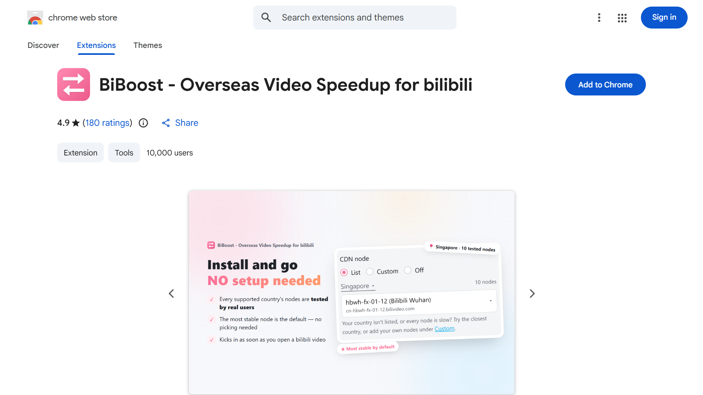
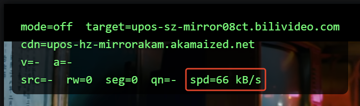
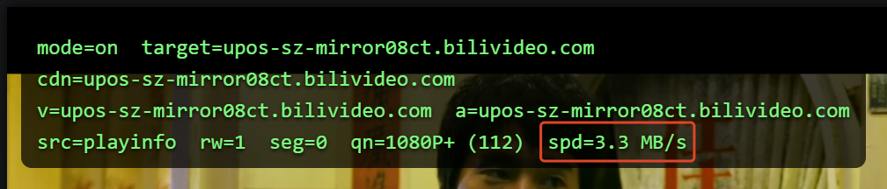

<div align="center">

#  BiBoost - Overseas Video Speedup for bilibili

**Language:** [繁體中文](docs/README.zh-TW.md)｜[简体中文](docs/README.zh-CN.md)｜English (this page)｜[日本語](docs/README.ja.md)｜[한국어](docs/README.ko.md)

### An extension that makes bilibili web playback smoother for overseas viewers: 4K with no buffering, no more stuttering

</div>

 [Chrome Web Store](https://chromewebstore.google.com/detail/dfaddcffoondcendifiljhdbdagebgch?utm_source=github&utm_medium=referral&utm_campaign=readme&utm_content=en)<br>
 [Firefox Add-ons](https://addons.mozilla.org/addon/bilibili-cdn-switcher?utm_source=github&utm_medium=referral&utm_campaign=readme&utm_content=en)<br>
 [Edge Add-ons](https://microsoftedge.microsoft.com/addons/detail/dllallgilijcacpdemjafegibdafcbdp?utm_source=github&utm_medium=referral&utm_campaign=readme&utm_content=en)<br>
 [Safari (Mac)](https://apps.apple.com/app/id6817181919?platform=mac&pt=129529980&ct=github_readme_en)<br>
 [Safari (iPhone / iPad)](https://apps.apple.com/app/id6817181919?platform=iphone&pt=129529980&ct=github_readme_en_ios)

---

<div align="center">



</div>

---

Before (extension off)



After (extension on)



## ✨ What this extension does

**🎯 It exists to make bilibili's web player (www.bilibili.com) smoother for overseas viewers (outside mainland China).**

Bilibili's default CDN assignment often routes overseas users through slow, roundabout paths. This extension **reorders the video-fetching CDNs and switches to the best node that tested faster for your region**, so buffering and loading are smoother.

| Feature | Description |
|:--|:--|
| 🚀 **Zero setup, works out of the box** | Right after installing, it works out your country from your IP in the background and switches to the CDN that tested fastest there — no need to open the settings or pick a node yourself |
| 🧑‍🔬 **Real-user speed tests, many countries** | Every country's node list is picked from speed tests run by local users on their own connections. Currently supported: Taiwan, Singapore, Hong Kong, Japan, Australia, the US, Macau, the UK, Spain and Russia, with more on the way; regions without their own list get the cross-region "Other regions" list, picked from every country's reports |
| ✏️ **Custom node list** | Tailor your own nodes to your network: download the official speed test tool **[CDNSpeedTest](https://lazy-cv.com/docs/bilibili-cdn-speedtest?utm_source=github&utm_medium=referral&utm_campaign=readme&utm_content=en)** (Windows / Mac) and run it once, and the nodes that suit you best are added to the extension automatically; you can also enter several CDN hosts yourself, with the same speed test and sorting |
| 📶 **Per-node speed test** | A speed-test page inside the popup (shared by video and live) showing the video title/quality; measures download speed for each node using the current video at its current quality, listed one by one with a label showing whether each node is good for 8K/4K/1080p/720p or may stutter. Click any row to switch to that node; you can stop or retest mid-run, and leaving the page stops the test |
| 🔁 **Auto-optimize node on stalls** | When a segment request to the current CDN fails or playback keeps stalling (not just a full buffer), it first speed-tests the nodes in your current list in the background, once per video: the current node stays if it reaches the 4K standard (25 Mbps), otherwise it switches to the first node that does (or the fastest one measured if none does) and saves it as your node. If playback still stalls, it silently switches to bilibili's own backup node (with a toast, usually without a full-page reload); if that backup also fails, it shows a prompt letting you decide whether to switch to the "Backup URL". Can be turned off with the "Auto-optimize node when slow" toggle in Advanced settings (on by default); turn it off if your own network is unstable |
| 📺 **Live-stream support** | The "Live" tab switches between International (ov) / International backup (ov-b) / China (cn) / China backup (cn-b) without reloading the page. Actual route URLs are shown only once you are in a live room and it is playing; routes the current stream does not have are labelled and dimmed (still selectable). When a live route performs badly, "Auto-optimize node when slow" falls back to International (ov) automatically (for that room only, without changing your long-term choice) |
| 🦊 **Chrome / Firefox / Edge / Safari** | A single `src/` tree; packaging produces a per-browser zip (Edge is Chromium-based and reuses Chrome's manifest as-is); Safari is packaged into a `.app` via Xcode (see "Packaging Safari" below) |
| 🌏 **Multi-language UI** | Automatically shows Traditional Chinese / Simplified Chinese / English / Japanese / Korean based on your browser language (or pick one manually in Advanced settings), covering the popup, in-page toasts, and the debug overlay |
| 💬 **Report a problem / Request a feature** | Report a problem or request a feature straight from the popup; once sent, an issue is opened on GitHub so you can follow its progress. The full diagnostics attached to a problem report are never made public |
| 📢 **Announcements** | The announcement bar at the top of the main page shows announcements for your country (such as speed-test prize draws); click one to read it in full |
| ☕ **Support · Top Patrons** | BiBoost is free forever; if you'd like to support development, you can tip from the main page and get onto the Top Patrons board, ranked by total amount (no tipping in the Safari version) |
| 🐛 **Debug overlay** | Shows the currently active CDN node (off by default; turn it on in Advanced settings behind the gear icon at the top right) |

---

## 🗂️ Project structure

```text
bilibili-cdn-switcher/
├── src/                  ← The extension itself (what "Load unpacked" / packaging uses): manifest, popup, scripts injected into bilibili pages,
│                            tip / announcement / bug-report pages, node list cdn-list.json, release notes changelog.json, five-language _locales/
├── safari/               ← Safari extension Xcode project (generated by safari-web-extension-converter; references ../../../src/ via relative paths)
├── tools/
│   ├── cdn-speedtest-app/    ← Official speed test tool CDNSpeedTest (Python, Windows / Mac)
│   ├── report-worker/        ← api.biboost.app: bug-report, announcement, tipping and other APIs (Cloudflare Worker)
│   │                         Account & subscription API on the same host (/auth/*, /me, /play/*, /stripe/*, /config/*) is served by the biboost-mobile repo's api-worker, storing its tables in this project's Neon Postgres (bilibili-cdn-switcher: production branch for api.biboost.app, staging branch for api-staging.biboost.app), so the extension and the app share one backend and one database
│   ├── site/                 ← biboost.app website (Cloudflare Worker)
│   └── translate-worker/     ← Translation API used by the admin console (Cloudflare Worker)
├── scripts/              ← Dev / build / release / operations scripts (mostly Node, a few Python)
├── test/                 ← Unit tests (npm test)
├── assets/               ← 512px icon master and store-build icons (icons-prod is generated by gen-icons.mjs)
├── docs/                 ← README screenshots, platform icons + the Traditional Chinese / Simplified Chinese / Japanese / Korean READMEs
├── dist/                 ← Packaged output (.zip for Chrome/Firefox/Edge; .app for Safari)
├── .githooks/            ← pre-push release-notes check, private repo auto-sync
├── .github/workflows/    ← GitHub Actions: Safari build and App Store upload, Mac build of the speed test tool, etc.
├── package.json          ← Node deps for scripts/*.mjs and the tests
├── .env.local.example    ← Sample local credentials: store API keys, bilibili login cookie (copy to .env.local and fill in)
└── README.md
```

Store copy and screenshots (`store/`), promotion, research data and other non-public files live in a separate private repo, not here (see `scripts/private-repo.mjs`).

The packaging scripts (`build.mjs`, `build-safari.mjs`, `gen-icons.mjs`, etc.) are plain Node (zipping via [jszip](https://npm.im/jszip), image work via [sharp](https://npm.im/sharp)),
with no dependency on Windows-only PowerShell or System.Drawing, so they run the same way on Mac / Linux. Just `npm install` once to pull in the dependencies.

### 📦 Packaging (for Chrome Web Store / Firefox Add-ons / Microsoft Edge Add-ons)

There's no compile/transpile step — `src/` is plain source you can `Load unpacked` directly. "Packaging" just zips it up for store submission,
and **there's no automation for it (e.g. nothing packages automatically before a push)** — you need to run it by hand whenever `dist/` needs updating:

```bash
npm install                          # first run, or whenever node_modules has been wiped
npm run build                        # Default: package Chrome + Firefox + Edge
npm run build -- --browser=chrome     # Chrome only
npm run build -- --browser=firefox    # Firefox only
npm run build -- --browser=edge       # Edge only
```

Chrome and Edge share `src/manifest.json` (Edge is Chromium-based and fully compatible with Chrome's Manifest V3,
so no separate manifest is needed); Firefox uses `src/manifest.firefox.json`. The script reads `version` from the matching manifest and
zips the **contents of `src/`** (with the chosen manifest renamed to `manifest.json` at the zip root) into
`dist/bilibili-cdn-switcher-<browser>-<version>.zip`. The `version` in the Chrome and Firefox manifests
must stay in sync — the script warns if they diverge (Edge reuses Chrome's manifest, so its version is always in sync and needs no separate check).

The build is reproducible: as long as `src/` hasn't changed, packaging the same browser target always produces
byte-identical zips (Windows and Mac included), which makes it easy to check later on whether `dist/` actually needs updating if this ever gets wired into CI.

### 🧪 Tests

```bash
npm test                             # runs test/*.test.mjs (Node's built-in test runner)
npm run test:whats-new               # loads src/ in puppeteer's Chrome and tests the "What's new" popup automatically
```

### 📝 Release notes and releases

- `src/changelog.json` records both "new features not yet released (`unreleased`)" and "what each released version added over the previous one (`releases`)", in five languages (zh_TW / zh_CN / en / ja / ko).
  The first time existing users open the popup after an update, they see a one-off "What's new" popup (its content comes from this file; `unreleased` is stripped automatically when packaging the zip).
- `.githooks/pre-push`: on push, if `src/changelog.json` hasn't changed compared with the commit the branch was created from, it asks whether to push anyway; choosing No blocks the push.
  `npm install` sets `core.hooksPath` automatically (or run `git config core.hooksPath .githooks` by hand). When you're sure nothing needs recording: `CHANGELOG_CHECK_IGNORE=1 git push`.
- Releases are done with Claude Code's `/release` (`.claude/skills/release/SKILL.md`); store API keys go in `.env.local` (see `.env.local.example`). The stores' "Publish" buttons are always pressed by hand.
- `npm run package`: besides the store-upload zips in `dist/`, it also packages the zips for offline installation and `CDNSpeedTest.exe` into `release/`, which `/release` uploads to that version's GitHub Release.

### 🍎 Packaging Safari (for the App Store)

Safari extensions can't be loaded straight from a zip like Chrome — they must be wrapped in a containing app (a `.app` on macOS, an `.ipa` on iOS)
and distributed through the App Store. The `safari/` folder is the Xcode project generated by `xcrun safari-web-extension-converter`; it references the repo's `src/` directly
via relative paths (`../../../src/`), so **editing `src/` requires no file syncing** — just repackage and it picks up the latest. It also builds on any
Mac after cloning the whole repo (there are no hardcoded absolute paths in the project).

**Requirement**: a Mac with the full Xcode installed (Command Line Tools alone isn't enough).

```bash
npm run build:safari                       # macOS, Release, ad-hoc signing → dist/
npm run build:safari -- --platform=ios     # build for iOS instead
npm run build:safari -- --configuration=Debug
```

The script calls `xcodebuild` and overrides `MARKETING_VERSION` with the `version` from `src/manifest.json` (so the .app's internal version matches the extension —
the Xcode project hardcodes 1.0 by default), producing two things:

- `dist/Bilibili CDN Switcher (<platform>).app` — the app you can double-click to install/test
- `dist/bilibili-cdn-switcher-safari-<platform>-<version>.zip` — following the same `bilibili-cdn-switcher-<platform>-<version>` naming convention as the other platforms, for handing to another machine

⚠️ This uses **ad-hoc signing and is for local testing only**. Actual App Store submission still goes through Xcode: open the project under `safari/` →
Product > Archive > Distribute App, signing with your Apple Developer account (this step needs signing credentials and can't be done purely from the command line).

### 🎨 Regenerating icons

```bash
npm run gen-icons
```

Scales the 512px master down to 16/32/48/128, producing two sets: `src/icons/` (dev build, with a red badge dot — what `Load unpacked` normally reads, so it's easy to tell apart from an installed store build) and `assets/icons-prod/` (store build, no badge). `scripts/build.mjs` automatically swaps in the icons from `assets/icons-prod/` when packaging zips.

## 🎛️ UI reference

| Option | Behavior |
|:--|:--|
| 🏠 **Main page** | The announcement bar sits at the top, with the "Enabled" switch and the video / live node settings in the middle. At the bottom are three buttons for rating, tipping and reporting a problem, plus the version number (click it to see the full release notes) |
| 🔄 **This tab needs a refresh** | Right after the extension is installed or updated, bilibili tabs that were already open need a refresh before it takes effect; the popup shows a notice with a "Refresh" button |
| 📢 **Announcement bar** | Shows only announcements for your country (such as speed-test prize draws); click one to read it in full. Press × to close it and hide it for 3 days |
| 🔘 **Enabled** | Master switch, on by default, covering both video and live. When off, bilibili's stream fetching is left completely untouched |
| 🎞️ **Video / Live tabs** | Below "Enabled" the popup is split into Video and Live tabs. When opened in a live room, it starts on "Live" |
| 📡 **CDN Route** | "List" / "Custom" / "Off", mutually exclusive; the default is List. The list shows, per country, the 10-odd nodes that tested fastest, covering users of every ISP, and your country is picked automatically from your IP after installing; countries without their own list use "Other regions". With Custom you can type in hosts yourself, or have them added automatically after a CDNSpeedTest run |
| 🔍 **Test node speeds** | Measures the download speed of every node in the list using the current video at its current quality; the three fastest get a crown. Click any row to switch to that node; you can stop or retest at any time |
| ☕ **Support · Top Patrons** | A leaderboard of patrons ranked by total amount, with tips paid through Stripe. Tipping doesn't unlock any features, and the Safari version doesn't have this button |
| 💬 **Report a problem / Request a feature** | Report a problem or request a feature in a separate window; once sent, an issue is opened on GitHub. The full diagnostics attached to problem reports are never made public |
| 📺 **Live route** | Choose between International (ov) / International backup (ov-b) / China (cn) / China backup (cn-b); the default is International (ov). What's remembered is the route type, so it also applies when you switch live rooms |
| 🔍 **Test live routes** | While a live room is playing, measures each route's switch lag (startup time) and keeping up (whether it keeps pace), marked good to bad in green / yellow / red |
| ⚙️ **Advanced settings (gear icon, top right)** | Language, theme, auto-optimization, speed-test limits, node sorting, the debug overlay and other settings all live here. "Reset all settings" at the very bottom restores the defaults in one click |
| 🌏 **Language** | Follows your browser language by default, supporting Traditional Chinese / Simplified Chinese / English / Japanese / Korean; it can also be set manually in Advanced settings |
| 🎨 **Theme** | System (default) / Light / Dark |
| 🔁 **Automatic CDN optimization on stalls** | On detecting stalls or failed segment loads, it first speed-tests in the background and switches to a node fast enough for 4K (25 Mbps); if playback still stalls, it switches to bilibili's own backup node. On by default; turning it off is recommended if your own network is unstable |
| ⚡ **First-video node optimization after install** | Runs only once, after a fresh install: about 5 s after your first video starts playing, it speed-tests in the background and switches automatically if the current node isn't fast enough |
| ⏱️ **Speed-test limits** | Video and live each offer three presets, "Fast - less accurate" / "Balanced" / "Slow - more accurate", or your own numbers, adjusting how long the speed test runs and how accurate it is |
| 🔢 **Sort nodes by speed test** | On by default. Tested nodes are ordered fastest first, and the node list on the main page follows the same order |
| 🐛 **Show debug overlay on page** | Off by default. When on, technical info such as the node in use is shown at the top-left of the player |
| ♻️ **Reset all settings** | Returns all settings to their defaults and clears the custom node list |

<details>
<summary>🔍 <b>What the debug overlay looks like</b> (top-left of the player)</summary>

Video page:

```text
mode=on  target=<node you chose>
auto-fallback -> <backup node switched to automatically>        ← only shown after an automatic switch
cdn=<host actually streaming right now>
v=<video host in use>  a=<audio host in use>
src=playinfo|playurl  rw=<rewrite count>  seg=<segment swap count>  qn=<quality>  spd=<speed>
buf=<buffer ahead>s  rs=<readyState> [paused]  stall=<seconds stalled>/<threshold>  fb=<fallback count>/2 [cd=<cooldown left>]  lat=<segment latency>
err=<last error> (<N>s ago)                    ← only shown when there's an error
-<N>s  <recent event>                              ← up to 3 entries
```

Live room:

```text
mode=on  target=<route you chose>
auto-fallback -> <route fallen back to automatically>              ← only shown after an automatic fallback
cdn=<host actually streaming right now>
proto=<protocol>  cluster=<cluster number>  orig=<original route>  seg=<segment swap count>  pin=<whether playinfo is pinned>
(the rest is the same as the video page: buf=… / err=… / recent events)
```

</details>

---

## ☕ Buy me a coffee

BiBoost is free forever, maintained by one indie developer after work. If you like it, consider buying me a coffee! As a thank-you for your generosity, you can pick your own name and avatar to appear on the Top Patrons list.

<div align="center">

<a href="https://biboost.app/donate?utm_source=github&utm_medium=referral&utm_campaign=readme&utm_content=en"></a>

<a href="https://biboost.app/donate?utm_source=github&utm_medium=referral&utm_campaign=readme&utm_content=en"></a>

<sub>Or scan the QR code with your phone</sub>

</div>

---

## 📜 License

The source is public under a custom **[Source-Available License](LICENSE)**:

- ✅ You may view, fork, and modify the source; personal use, teaching/research, and other non-commercial uses are freely permitted
- ❌ You may not repackage this project or a modified version as a competing browser extension/app/service and publish it, nor remove copyright notices
- See [LICENSE](LICENSE) for full terms; for commercial partnerships or an exception, please open an issue

Privacy policy: [PRIVACY.md](PRIVACY.md)

---

<div align="center">

Made with ❤️ for bilibili viewers overseas · Inspired by [@roge4444](https://github.com/roge4444)'s [PiliNaraRogerMod](https://github.com/roge4444/PiliNaraRogerMod) / [blblRogerMod](https://github.com/roge4444/blblRogerMod)

</div>
