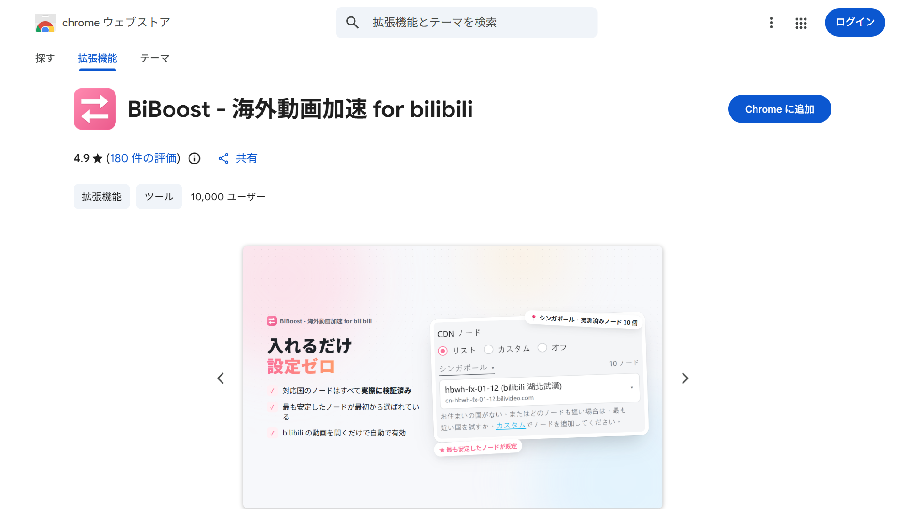
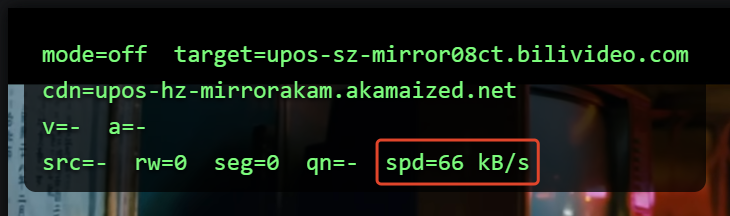
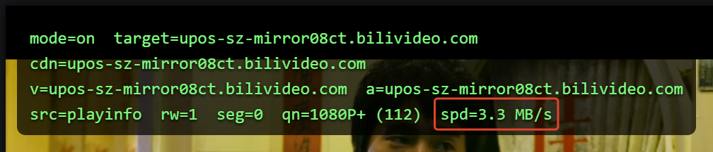

<div align="center">

#  BiBoost - 海外動画加速 for bilibili

**言語 / Language：** [繁體中文](README.zh-TW.md)｜[简体中文](README.zh-CN.md)｜[English](../README.md)｜日本語（このページ）｜[한국어](README.ko.md)

### 海外から Web 版 bilibili をもっとスムーズに。4K もバッファリングなしで再生でき、カクつきに悩まされない拡張機能

</div>

 [Chrome Web Store](https://chromewebstore.google.com/detail/dfaddcffoondcendifiljhdbdagebgch?utm_source=github&utm_medium=referral&utm_campaign=readme&utm_content=ja)<br>
 [Firefox Add-ons](https://addons.mozilla.org/addon/bilibili-cdn-switcher?utm_source=github&utm_medium=referral&utm_campaign=readme&utm_content=ja)<br>
 [Edge Add-ons](https://microsoftedge.microsoft.com/addons/detail/dllallgilijcacpdemjafegibdafcbdp?utm_source=github&utm_medium=referral&utm_campaign=readme&utm_content=ja)<br>
 [Safari（Mac）](https://apps.apple.com/jp/app/id6817181919?platform=mac&pt=129529980&ct=github_readme_ja)<br>
 [Safari（iPhone／iPad）](https://apps.apple.com/jp/app/id6817181919?platform=iphone&pt=129529980&ct=github_readme_ja_ios)

---

<div align="center">



</div>

---

使用前（拡張機能オフ）



使用後（拡張機能オン）



## ✨ この拡張機能でできること

**🎯 海外（中国本土以外）から Web 版 bilibili（www.bilibili.com）をスムーズに見るための拡張機能です。**

bilibili が標準で割り当てる CDN ノードは、海外ユーザーにとって遠回りで遅い経路になりがちです。この拡張機能は、**動画を取得する CDN を並べ替え、お住まいの地域で実測して速かった最適なノードに切り替え**、バッファリングや読み込みをスムーズにします。

| 機能 | 説明 |
|:--|:--|
| 🚀 **設定不要、すぐに使える** | インストールするとバックグラウンドで IP からお住まいの国を判定し、その国で実測して最速だった CDN に自動で切り替えます。設定を開く必要も、ノードを自分で選ぶ必要もありません |
| 🧑‍🔬 **実ユーザーによる実測、多くの国に対応** | 各国のノードリストは、現地のユーザーが自分の回線で実際にテストした結果から選んでいます。台湾、シンガポール、香港、日本、オーストラリア、アメリカ、マカオ、イギリス、スペイン、ロシアに対応済みで、ほかの国も順次追加中です。専用リストのない地域では、各国のレポートから選んだ、地域をまたいで使える「その他の地域」リストを使います |
| ✏️ **カスタムノードリスト** | ご自身のネットワーク環境に合わせた専用ノードを用意できます。公式の速度テストツール **[CDNSpeedTest](https://lazy-cv.com/docs/bilibili-cdn-speedtest?utm_source=github&utm_medium=referral&utm_campaign=readme&utm_content=ja)**（Windows／Mac）で一度テストすると、最適なノードが拡張機能に自動で追加されます。CDN ホストを自分で複数入力することもでき、同じく速度テストと並べ替えに対応しています |
| 📶 **ノード別速度テスト** | ポップアップ内の速度テストページ（動画・ライブ共通）で動画タイトルと画質を表示し、現在の動画・現在の画質で各ノードのダウンロード速度を実測して一覧表示します。8K／4K／1080p／720p を安定して見られるか、カクつく可能性があるかも表示します。行をクリックするとそのノードに切り替わります。テスト中は停止や再テストができ、ページを離れるとテストは中止されます |
| 🔁 **カクつき時にノードを自動最適化** | 現在の CDN でセグメントのリクエストが失敗したり、再生が止まり続けたり（バッファが満杯なだけの状態は除く）したことを検出すると、動画ごとに 1 回、まず現在のリストのノードをバックグラウンドでテストします。現在のノードが 4K の目安（25 Mbps）に届いていればそのまま、届いていなければ最初に届いたノード（どれも届かなければ最速のノード）に切り替え、選択中のノードとして保存します。それでも止まる場合は、bilibili 標準のバックアップノードへ自動で切り替えます（通知を表示。通常はページ全体の再読み込みなし）。バックアップでもだめなときはメッセージを表示し、「バックアップ URL」に切り替えるかどうかをご自身で決められます。詳細設定の「遅いときにノードを自動最適化」スイッチでオフにできます（既定はオン）。ネットワーク自体が不安定な場合はオフをおすすめします |
| 📺 **ライブ配信に対応** | 「ライブ」タブで 国際回線(ov)／国際予備回線(ov-b)／中国回線(cn)／中国予備回線(cn-b) をページ全体を再読み込みせずに切り替えられます。各回線の実際の URL はライブ配信ページで再生が始まってから表示され、現在の配信にない回線にはその旨が表示されてグレーになります（選択は可能）。ライブ回線が不調なときは、「遅いときにノードを自動最適化」が国際回線(ov) に自動で戻します（その配信だけが対象で、普段の選択は変わりません） |
| 🦊 **Chrome / Firefox / Edge / Safari の 4 プラットフォーム** | ソースは同じ `src/` 1 つで、パッケージ化のときにブラウザごとの zip を出力します（Edge は Chromium ベースなので Chrome の manifest をそのまま使用）。Safari は別途 Xcode で `.app` にパッケージ化します（下の「Safari のパッケージ化」を参照） |
| 🌏 **多言語 UI** | ブラウザの言語に合わせて繁体字中国語／簡体字中国語／英語／日本語／韓国語を自動表示（詳細設定で手動選択も可能）。ポップアップ、ページ内のメッセージ、デバッグ表示のすべてに対応 |
| 💬 **問題の報告／機能リクエスト** | ポップアップから直接、問題を報告したり新機能をリクエストしたりできます。送信すると GitHub に issue が作成され、進捗を追えます。問題の報告に添付される詳しい診断データは公開されません |
| 📢 **お知らせ** | メインページ上部のお知らせバーに、お住まいの国向けのお知らせ（速度テストの抽選キャンペーンなど）を表示し、開くと全文を読めます |
| ☕ **支援・石油王ランキング** | BiBoost は永久無料です。開発を応援したい方はメインページから支援でき、累計金額順の石油王ランキングに載ります（Safari 版には支援機能はありません） |
| 🐛 **デバッグ表示** | 現在の CDN ノードを確認できます（既定はオフ。右上の歯車の詳細設定でオンにできます） |

---

## 🗂️ プロジェクト構成

```text
bilibili-cdn-switcher/
├── src/                  ← 拡張機能本体（「パッケージ化されていない拡張機能を読み込む」／パッケージ化の対象はこの階層）：manifest、ポップアップ、bilibili のページに注入するスクリプト、
│                            支援／お知らせ／問題報告ページ、ノード一覧 cdn-list.json、更新履歴 changelog.json、5 言語の _locales/
├── safari/               ← Safari 拡張機能の Xcode プロジェクト（safari-web-extension-converter で生成。相対パスで ../../../src/ を直接参照）
├── tools/
│   ├── cdn-speedtest-app/    ← 公式速度テストツール CDNSpeedTest（Python、Windows／Mac）
│   ├── report-worker/        ← api.biboost.app：問題報告、お知らせ、支援などの API（Cloudflare Worker）
│   │                         同じホスト上のアカウント／サブスクリプション API（/auth/*、/me、/play/*、/stripe/*、/config/*）は biboost-mobile リポジトリの api-worker が提供し、テーブルはこのプロジェクトの Neon Postgres（bilibili-cdn-switcher：production ブランチ＝api.biboost.app、staging ブランチ＝api-staging.biboost.app）に置く。拡張機能とアプリで同一バックエンド・同一データベースを共用
│   ├── site/                 ← biboost.app のウェブサイト（Cloudflare Worker）
│   └── translate-worker/     ← 管理画面用の翻訳 API（Cloudflare Worker）
├── scripts/              ← 開発／パッケージ化／リリース／運用スクリプト（主に Node、一部 Python）
├── test/                 ← 単体テスト（npm test）
├── assets/               ← 512px アイコンの原本と正式版アイコン（icons-prod は gen-icons.mjs が生成）
├── docs/                 ← README 用スクリーンショット、プラットフォームアイコン + 繁体字中国語／簡体字中国語／日本語／韓国語の README
├── dist/                 ← パッケージ化の出力（Chrome/Firefox/Edge は .zip、Safari は .app）
├── .githooks/            ← pre-push の更新履歴チェック、非公開リポジトリの自動同期
├── .github/workflows/    ← GitHub Actions：Safari のパッケージ化とストア公開、Mac 版速度テストツールのパッケージ化など
├── package.json          ← scripts/*.mjs とテスト用の Node の依存
├── .env.local.example    ← ローカル認証情報のサンプル：ストア公開用キー、bilibili ログイン cookie（.env.local にコピーして記入）
└── README.md
```

ストア用の紹介文とスクリーンショット（`store/`）、プロモーション、研究データなど公開しないファイルは別の非公開リポジトリで管理しており、ここには含まれません（`scripts/private-repo.mjs` を参照）。

パッケージ化関連のスクリプト（`build.mjs`、`build-safari.mjs`、`gen-icons.mjs` など）はすべて純粋な Node（zip は [jszip](https://npm.im/jszip)、画像処理は [sharp](https://npm.im/sharp)）で、
Windows 専用の PowerShell や System.Drawing には依存しないため、Mac／Linux でも同じように動きます。最初に `npm install` で依存を入れるだけです。

### 📦 パッケージ化（Chrome Web Store / Firefox Add-ons / Microsoft Edge Add-ons 提出用）

このプロジェクトにはコンパイルやトランスパイルの工程はなく、`src/` はそのまま `Load unpacked` で読み込めるソースです。「パッケージ化」はストア提出用に zip にまとめるだけで、
**自動化はしていません（push 前に自動でパッケージ化するなどの仕組みはありません）**。`dist/` を更新したいときは手動で実行してください：

```bash
npm install                          # 初回、または node_modules を消したあとだけ必要
npm run build                        # 既定：Chrome + Firefox + Edge をすべてパッケージ化
npm run build -- --browser=chrome     # Chrome のみ
npm run build -- --browser=firefox    # Firefox のみ
npm run build -- --browser=edge       # Edge のみ
```

Chrome と Edge は同じ `src/manifest.json` を使い（Edge は Chromium ベースで、Manifest V3 は Chrome と完全互換のため、
専用の manifest は不要）、Firefox は `src/manifest.firefox.json` を使います。スクリプトは対応する manifest の `version` を読み、
**`src/` の中身**（manifest は `manifest.json` に改名して zip の最上位に配置）を
`dist/bilibili-cdn-switcher-<browser>-<version>.zip` にまとめます。Chrome と Firefox の 2 つの manifest の `version`
はそろえておく必要があり、ずれているとスクリプトが警告します（Edge は Chrome の manifest を使うので必ず一致し、個別のチェックは不要）。

ビルドは再現可能（reproducible build）です。`src/` の内容が変わっていなければ、同じブラウザ向けのパッケージ化は毎回
バイト単位で同一の zip を出力します（Windows と Mac の間でも同じ）。将来 CI に組み込むときも、`dist/` を本当に更新する必要があるかを判断しやすくなります。

### 🧪 テスト

```bash
npm test                             # test/*.test.mjs を実行（Node 組み込みのテストランナー）
npm run test:whats-new               # puppeteer の Chrome で src/ を読み込み、「更新内容」ポップアップを自動テスト
```

### 📝 更新履歴とリリース

- `src/changelog.json` には「まだ公開していない新機能（`unreleased`）」と「公開済みの各バージョンで前のバージョンから追加された内容（`releases`）」の両方を、5 言語（zh_TW / zh_CN / en / ja / ko）で記録しています。
  既存ユーザーがアップデート後に初めてポップアップを開くと、1 回だけ「更新内容」ポップアップが表示されます（内容はこのファイルから取得。zip にパッケージ化するときは `unreleased` が自動で取り除かれます）。
- `.githooks/pre-push`：push 時に、分岐元の基準コミットと比べて `src/changelog.json` に変更がないと、それでも push するかを確認し、No を選ぶと中止します。
  `npm install` で `core.hooksPath` が自動で設定されます（手動なら `git config core.hooksPath .githooks`）。記録が不要だとわかっている場合：`CHANGELOG_CHECK_IGNORE=1 git push`。
- リリースは Claude Code の `/release`（`.claude/skills/release/SKILL.md`）で行います。ストア公開用のキーは `.env.local` に置きます（`.env.local.example` を参照）。ストアの「公開」ボタンは必ず人が手動で押します。
- `npm run package`：`dist/` のストアアップロード用 zip に加えて、オフラインインストール用の zip と `CDNSpeedTest.exe` を `release/` にまとめ、`/release` がそのバージョンの GitHub Release にアップロードします。

### 🍎 Safari のパッケージ化（App Store 提出用）

Safari の拡張機能は Chrome のように zip から直接読み込めず、「拡張機能を含むアプリ」（macOS は `.app`、iOS は `.ipa`）に包んで、
App Store で配布する必要があります。`safari/` は `xcrun safari-web-extension-converter` で生成した Xcode プロジェクトで、相対パス
（`../../../src/`）でリポジトリの `src/` を直接参照しているため、**`src/` を編集してもファイルを同期する必要はなく**、パッケージ化し直すだけで最新の内容が入ります。
リポジトリ全体を clone すればどの Mac でもビルドできます（プロジェクトに絶対パスは含まれていません）。

**必要なもの**：Xcode 本体をインストールした Mac（Command Line Tools だけでは不十分）。

```bash
npm run build:safari                       # macOS、Release、ad-hoc 署名 → dist/
npm run build:safari -- --platform=ios     # iOS 向けにパッケージ化
npm run build:safari -- --configuration=Debug
```

スクリプトは `xcodebuild` を呼び出し、`MARKETING_VERSION` を `src/manifest.json` の `version` で上書きします（`.app` 内部のバージョンを拡張機能と一致させるため。
Xcode プロジェクトの既定値は 1.0 固定）。出力は次の 2 つです：

- `dist/Bilibili CDN Switcher (<platform>).app` —— ダブルクリックでインストール／テストできるアプリ
- `dist/bilibili-cdn-switcher-safari-<platform>-<version>.zip` —— ほかのプラットフォームの `bilibili-cdn-switcher-<platform>-<version>` と同じ命名規則で、別のマシンに渡すとき用

⚠️ これは **ad-hoc 署名で、ローカルテスト専用**です。実際の App Store 提出は、Xcode で `safari/` 以下のプロジェクトを開く →
Product > Archive > Distribute App で、ご自身の Apple Developer アカウントで署名してアップロードします（署名証明書が必要なため、コマンドラインだけでは完結しません）。

### 🎨 アイコンの再生成

```bash
npm run gen-icons
```

512px の原本を 16/32/48/128 に縮小し、2 セットを出力します：`src/icons/`（開発版。赤い点のバッジ付きで、`Load unpacked` で普段読み込まれるのはこちら。インストール済みの正式版と見分けやすくするため）と `assets/icons-prod/`（正式版、バッジなし）。`scripts/build.mjs` は zip をパッケージ化するときに、アイコンを自動で `assets/icons-prod/` の正式版に差し替えます。

## 🎛️ UI の説明

| 項目 | 動作 |
|:--|:--|
| 🏠 **メインページ** | 上部はお知らせバー、中央に「有効」スイッチと動画／ライブのノード設定があります。最下部には評価・支援・問題の報告の 3 つのボタンと、バージョン番号（クリックするとすべての更新履歴を表示）があります |
| 🔄 **このタブは再読み込みが必要です** | 拡張機能をインストール・更新した直後は、すでに開いている bilibili のタブを再読み込みしないと反映されないため、ポップアップにメッセージと「再読み込み」ボタンを表示します |
| 📢 **お知らせバー** | お住まいの国向けのお知らせ（速度テストの抽選キャンペーンなど）だけを表示し、クリックすると全文を読めます。× を押すとそのお知らせを閉じ、3 日間表示しません |
| 🔘 **有効** | マスタースイッチで、既定はオン。動画とライブの両方を管理します。オフにすると bilibili のストリーム取得にはまったく手を加えません |
| 🎞️ **動画／ライブ タブ** | 「有効」の下は動画とライブの 2 つのタブに分かれています。ライブ配信ページで開くと、自動で「ライブ」になります |
| 📡 **CDN 回線** | 「リスト」／「カスタム」／「オフ」の排他選択で、既定はリストです。リストは国ごとに実測で最速だった 10 数個のノードを並べ、すべての ISP のユーザーをカバーします。インストールすると IP からお住まいの国を自動で選び、専用リストのない国では「その他の地域」を使います。カスタムノードリストには、ホストを自分で入力するか、CDNSpeedTest でテストすると自動で追加されます |
| 🔍 **各ノードの速度をテスト** | 現在の動画・現在の画質で、リスト内の各ノードのダウンロード速度を実測し、上位 3 つに王冠を付けます。行をクリックするとそのノードに切り替わり、いつでも停止・再テストができます |
| ☕ **支援・石油王ランキング** | 累計金額順の石油王ランキングで、Stripe を通じて支援できます。支援しても機能が解放されることはなく、Safari 版にはこのボタンはありません |
| 💬 **問題の報告／機能リクエスト** | 別ウィンドウで問題を報告したり機能をリクエストしたりでき、送信すると GitHub に issue が作成されます。問題の報告に添付される詳しい診断データは公開されません |
| 📺 **ライブ回線** | 国際回線(ov)／国際予備回線(ov-b)／中国回線(cn)／中国予備回線(cn-b) から選べ、既定は国際回線(ov)。記憶されるのは回線の種類なので、別のライブ配信でもそのまま使われます |
| 🔍 **ライブ回線の速度をテスト** | ライブ配信の再生中に、各回線の切り替え遅延（起動時間）と継続視聴（遅れずについていけるか）を実測し、良し悪しを緑／黄／赤で表示します |
| ⚙️ **詳細設定（右上の歯車）** | 言語、テーマ、自動最適化、速度テストの上限、ノードの並べ替え、デバッグ表示などの設定をここにまとめています。最下部の「初期設定に戻す」でワンクリックで既定に戻せます |
| 🌏 **言語** | 既定ではブラウザの言語に合わせます。繁體中文／简体中文／English／日本語／한국어 に対応し、詳細設定で手動で選ぶこともできます |
| 🎨 **テーマ** | システムに合わせる（既定）／ライト／ダーク |
| 🔁 **カクつき時にノードを自動最適化** | カクつきやセグメントの読み込み失敗を検出すると、まずバックグラウンドでテストして 4K に十分（25 Mbps）なノードに切り替えます。それでも止まる場合は bilibili 標準のバックアップノードに切り替えます。既定はオン。ネットワーク自体が不安定な場合はオフをおすすめします |
| ⚡ **インストール後、最初の動画でノードを自動最適化** | 新しくインストールしたあとに 1 回だけ実行されます。最初の動画の再生開始から約 5 秒後にバックグラウンドでテストし、現在のノードが遅ければ自動で切り替えます |
| ⏱️ **速度テストの上限** | 動画とライブそれぞれで、「高速 - 精度低め／標準／低速 - 精度高め」の 3 つのプリセットか数値の自由入力を選び、テストの時間と精度を調整できます |
| 🔢 **テスト結果でノードを並べ替え** | 既定はオン。テストしたノードを速い順に並べ、メインページのノード一覧もこの順序になります |
| 🐛 **ページにデバッグ情報を表示** | 既定はオフ。オンにすると、プレーヤーの左上に現在使用中のノードなどの技術情報を表示します |
| ♻️ **初期設定に戻す** | すべての設定を既定に戻し、カスタムノードリストをクリアします |

<details>
<summary>🔍 <b>デバッグ表示の見た目</b>（プレーヤーの左上）</summary>

動画ページ：

```text
mode=on  target=<選んだノード>
auto-fallback -> <自動で切り替えたバックアップノード>  ← 自動切り替えが起きたときだけ表示
cdn=<現在実際に配信しているホスト>
v=<主に使っている動画ホスト>  a=<主に使っている音声ホスト>
src=playinfo|playurl  rw=<書き換え回数>  seg=<セグメント差し替え回数>  qn=<画質>  spd=<速度>
buf=<先読みバッファ>s  rs=<readyState> [paused]  stall=<停止秒数>/<しきい値>  fb=<バックアップ切り替え回数>/2 [cd=<クールダウン残り>]  lat=<セグメント遅延>
err=<最後のエラー> (<N>s ago)                    ← エラーがあるときだけ表示
-<N>s  <最近のイベント>                          ← 最大 3 件
```

ライブ配信ページ：

```text
mode=on  target=<選んだ回線>
auto-fallback -> <自動で戻した回線>            ← 自動で戻したときだけ表示
cdn=<現在実際に配信しているホスト>
proto=<プロトコル>  cluster=<クラスタ番号>  orig=<元の回線>  seg=<セグメント差し替え回数>  pin=<playinfo を固定済みか>
（以下は動画ページと同じ：buf=… / err=… / 最近のイベント）
```

</details>

---

## ☕ コーヒーをおごってください

BiBoost は永久無料で、個人開発者が仕事終わりにメンテナンスしています。気に入っていただけたら、コーヒーを 1 杯おごってもらえるとうれしいです！感謝のしるしとして、好きな名前とアイコンで石油王ランキングに載ることができます

<div align="center">

<a href="https://biboost.app/donate?utm_source=github&utm_medium=referral&utm_campaign=readme&utm_content=ja"></a>

<a href="https://biboost.app/donate?utm_source=github&utm_medium=referral&utm_campaign=readme&utm_content=ja"></a>

<sub>スマホで QR コードを読み取って支援することもできます</sub>

</div>

---

## 📜 ライセンス

独自の **[Source-Available License](../LICENSE)** でソースを公開しています：

- ✅ ソースの閲覧、fork、改変が可能で、個人利用、教育・研究などの非商用利用は自由です
- ❌ 本プロジェクトや改変版を、競合するブラウザ拡張機能／アプリ／サービスとして再パッケージ化して公開・配布すること、著作権表示を削除することはできません
- 詳しい条文は [LICENSE](../LICENSE) を参照してください。商用での協業や例外の許諾については issue でご相談ください

プライバシーポリシー：[PRIVACY.md](../PRIVACY.md)

---

<div align="center">

Made with ❤️ for bilibili viewers overseas · Inspired by [@roge4444](https://github.com/roge4444)'s [PiliNaraRogerMod](https://github.com/roge4444/PiliNaraRogerMod) / [blblRogerMod](https://github.com/roge4444/blblRogerMod)

</div>
