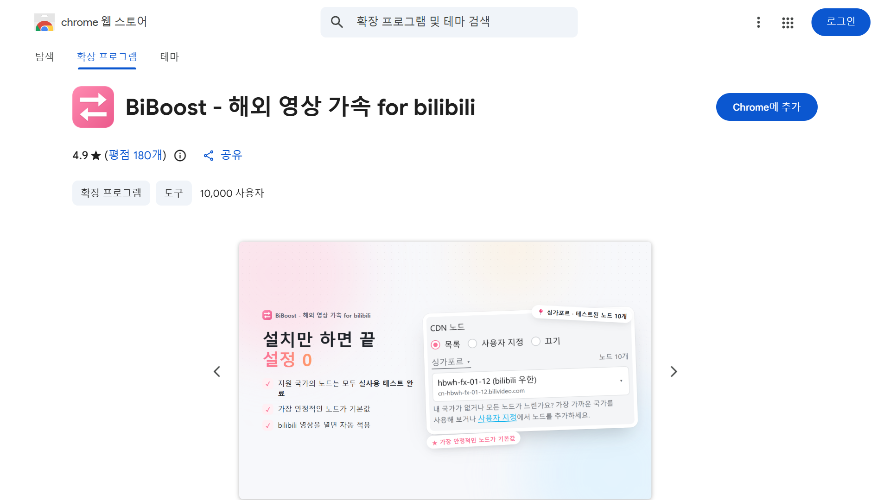
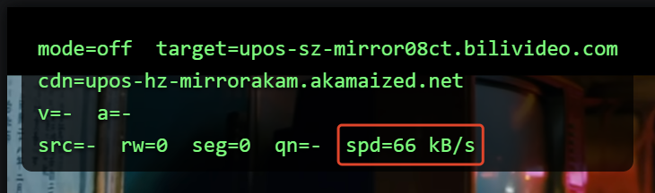
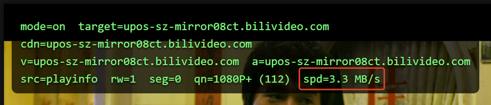

<div align="center">

#  BiBoost - 해외 영상 가속 for bilibili

**언어 / Language：** [繁體中文](README.zh-TW.md)｜[简体中文](README.zh-CN.md)｜[English](../README.md)｜[日本語](README.ja.md)｜한국어(이 페이지)

### 해외에서 웹 bilibili를 더 매끄럽게, 버퍼링 없이 4K로 재생하고 더 이상 끊김에 시달리지 않는 확장 프로그램

</div>

 [Chrome Web Store](https://chromewebstore.google.com/detail/dfaddcffoondcendifiljhdbdagebgch?utm_source=github&utm_medium=referral&utm_campaign=readme&utm_content=ko)<br>
 [Firefox Add-ons](https://addons.mozilla.org/addon/bilibili-cdn-switcher?utm_source=github&utm_medium=referral&utm_campaign=readme&utm_content=ko)<br>
 [Edge Add-ons](https://microsoftedge.microsoft.com/addons/detail/dllallgilijcacpdemjafegibdafcbdp?utm_source=github&utm_medium=referral&utm_campaign=readme&utm_content=ko)<br>
 [Safari(Mac)](https://apps.apple.com/kr/app/id6817181919?platform=mac&pt=129529980&ct=github_readme_ko)<br>
 [Safari(iPhone / iPad)](https://apps.apple.com/kr/app/id6817181919?platform=iphone&pt=129529980&ct=github_readme_ko_ios)

---

<div align="center">



</div>

---

사용 전(확장 프로그램 끔)



사용 후(확장 프로그램 켬)



## ✨ 이 확장 프로그램이 하는 일

**🎯 해외(중국 본토 외) 사용자가 웹 bilibili(www.bilibili.com)를 더 매끄럽게 볼 수 있도록 만든 확장 프로그램입니다.**

bilibili가 기본으로 배정하는 스트림 노드는 해외 사용자에게 돌아가는 경로가 되거나 충분히 빠르지 않은 경우가 많습니다. 이 확장 프로그램은 **영상을 가져오는 CDN의 순서를 다시 정해, 사용자 지역에서 실측해 더 빨랐던 최적의 노드로 바꿔** 버퍼링과 로딩을 더 매끄럽게 만들어 줍니다.

| 기능 | 설명 |
|:--|:--|
| 🚀 **설정 없이 바로 사용** | 설치하면 백그라운드에서 IP로 사용자 국가를 판단해, 그 국가에서 실측해 가장 빨랐던 CDN으로 자동 전환합니다. 설정을 열 필요도, 노드를 직접 고를 필요도 없습니다 |
| 🧑‍🔬 **실사용자 실측, 다국가 지원** | 국가별 노드 목록은 모두 현지 사용자가 자신의 네트워크로 직접 실측한 결과로 골랐습니다. 대만, 싱가포르, 홍콩, 일본, 호주, 미국, 마카오, 영국, 스페인, 러시아를 지원하며 다른 국가도 순차 추가 중입니다. 전용 목록이 없는 지역에서는 각국 보고서에서 골라낸, 여러 지역에서 두루 쓸 수 있는 「기타 지역」 목록을 사용합니다 |
| ✏️ **사용자 지정 노드 목록** | 사용자 네트워크 환경에 맞춘 전용 노드를 만들 수 있습니다. 공식 속도 테스트 도구 **[CDNSpeedTest](https://lazy-cv.com/docs/bilibili-cdn-speedtest?utm_source=github&utm_medium=referral&utm_campaign=readme&utm_content=ko)**(Windows / Mac)로 한 번 테스트하면 가장 잘 맞는 노드가 확장 프로그램에 자동으로 추가됩니다. CDN 호스트를 직접 여러 개 입력할 수도 있으며, 마찬가지로 속도 테스트와 정렬을 지원합니다 |
| 📶 **노드별 속도 테스트** | 팝업 안의 속도 테스트 페이지(영상·라이브 공용)에서 영상 제목과 화질을 보여 주고, 현재 영상·현재 화질에서 각 노드의 다운로드 속도를 실측해 하나씩 나열하며, 8K / 4K / 1080p / 720p를 원활하게 볼 수 있는지 끊길 수 있는지 표시합니다. 아무 행이나 누르면 그 노드로 전환되고, 테스트 중에도 중지하거나 다시 테스트할 수 있으며, 페이지를 벗어나면 테스트가 중단됩니다 |
| 🔁 **끊김 시 노드 자동 최적화** | 현재 CDN의 세그먼트 요청 실패나 계속되는 재생 멈춤(단순히 버퍼가 가득 찬 상태는 제외)을 감지하면, 영상마다 한 번 먼저 현재 목록의 노드를 백그라운드에서 테스트합니다. 현재 노드가 4K 기준(25 Mbps)에 도달하면 그대로 두고, 아니면 처음으로 기준에 도달한 노드(모두 미달이면 가장 빨랐던 노드)로 바꿔 사용자 노드로 저장합니다. 그래도 멈추면 bilibili가 기본 제공하는 백업 노드로 조용히 전환하고(알림 표시, 보통 페이지 전체 새로고침 없음), 백업도 안 되면 「백업 URL」로 전환할지 직접 정할 수 있도록 알림을 띄웁니다. 고급 설정의 「느릴 때 노드 자동 최적화」 스위치로 끌 수 있으며(기본값은 켬), 네트워크 자체가 불안정하다면 끄는 것을 권장합니다 |
| 📺 **라이브 방송 지원** | 「라이브」 탭에서 국제 회선(ov) / 국제 예비 회선(ov-b) / 중국 회선(cn) / 중국 예비 회선(cn-b)을 페이지 전체 새로고침 없이 전환할 수 있습니다. 각 회선의 실제 URL은 라이브 방송 페이지에서 재생이 시작된 뒤에 표시되며, 현재 방송에 없는 회선은 그렇다고 표시되고 흐리게 나타납니다(선택은 가능). 라이브 회선 상태가 나쁘면 「느릴 때 노드 자동 최적화」가 국제 회선(ov)으로 자동으로 되돌립니다(해당 라이브 방송에만 적용되며 평소 선택은 바꾸지 않음) |
| 🦊 **Chrome / Firefox / Edge / Safari 4개 플랫폼** | 소스는 `src/` 하나뿐이며, 패키징하면 브라우저별 zip이 각각 나옵니다(Edge는 Chromium 기반이라 Chrome의 manifest를 그대로 사용). Safari는 별도로 Xcode로 `.app`으로 패키징합니다(아래 「Safari 패키징」 참고) |
| 🌏 **다국어 UI** | 브라우저 언어에 맞춰 繁體中文 / 简体中文 / English / 日本語 / 한국어를 자동으로 표시합니다(고급 설정에서 직접 선택도 가능). 팝업, 페이지 내 알림, 디버그 오버레이 모두 지원합니다 |
| 💬 **문제 신고 / 기능 요청** | 팝업에서 바로 문제를 신고하거나 새 기능을 요청할 수 있으며, 보내면 GitHub에 issue가 열려 진행 상황을 확인하기 쉽습니다. 문제 신고에 첨부되는 전체 진단 데이터는 공개되지 않습니다 |
| 📢 **공지** | 메인 페이지 위쪽의 공지 바에 사용자 국가의 공지(예: 속도 테스트 추첨 이벤트)가 표시되며, 누르면 전문을 볼 수 있습니다 |
| ☕ **후원 · 회장님 랭킹** | BiBoost는 영원히 무료입니다. 개발을 응원하고 싶다면 메인 페이지에서 후원할 수 있고, 누적 금액 순으로 정렬되는 회장님 랭킹에 오르게 됩니다(Safari 버전에는 후원 기능이 없음) |
| 🐛 **디버그 오버레이** | 현재 CDN 노드를 확인할 수 있습니다(기본값은 끔. 오른쪽 위 톱니바퀴의 고급 설정에서 켤 수 있습니다) |

---

## 🗂️ 프로젝트 구조

```text
bilibili-cdn-switcher/
├── src/                  ← 확장 프로그램 본체(「압축해제된 확장 프로그램을 로드」/ 패키징 대상): manifest, 팝업, bilibili 페이지에 주입하는 스크립트,
│                            후원 / 공지 / 문제 신고 페이지, 노드 목록 cdn-list.json, 업데이트 기록 changelog.json, 5개 언어 _locales/
├── safari/               ← Safari 확장 프로그램 Xcode 프로젝트(safari-web-extension-converter로 생성, 상대 경로로 ../../../src/ 직접 참조)
├── tools/
│   ├── cdn-speedtest-app/    ← 공식 속도 테스트 도구 CDNSpeedTest(Python, Windows / Mac)
│   ├── report-worker/        ← api.biboost.app: 문제 신고, 공지, 후원 등의 API(Cloudflare Worker)
│   ├── site/                 ← biboost.app 웹사이트(Cloudflare Worker)
│   └── translate-worker/     ← 관리자 페이지용 번역 API(Cloudflare Worker)
├── scripts/              ← 개발 / 패키징 / 릴리스 / 운영 스크립트(주로 Node, 일부 Python)
├── test/                 ← 단위 테스트(npm test)
├── assets/               ← 512px 아이콘 원본과 정식 버전 아이콘(icons-prod는 gen-icons.mjs가 생성)
├── docs/                 ← README 스크린샷, 플랫폼 아이콘 + 繁體中文 / 简体中文 / 日本語 / 한국어 README
├── dist/                 ← 패키징 결과물(Chrome/Firefox/Edge는 .zip, Safari는 .app)
├── .githooks/            ← pre-push 업데이트 기록 검사, 비공개 저장소 자동 동기화
├── .github/workflows/    ← GitHub Actions: Safari 패키징 및 스토어 등록, Mac용 속도 테스트 도구 패키징 등
├── package.json          ← scripts/*.mjs와 테스트에 쓰는 Node 의존성
├── .env.local.example    ← 로컬 자격 증명 예시: 스토어 게시 키, bilibili 로그인 cookie(.env.local로 복사한 뒤 입력)
└── README.md
```

스토어 소개문과 스크린샷(`store/`), 홍보, 연구 자료 등 공개하지 않는 파일은 별도의 비공개 저장소에 있으며 여기에는 없습니다(`scripts/private-repo.mjs` 참고).

패키징 관련 스크립트(`build.mjs`, `build-safari.mjs`, `gen-icons.mjs` 등)는 모두 순수 Node(zip은 [jszip](https://npm.im/jszip), 이미지 처리는 [sharp](https://npm.im/sharp))로,
Windows 전용 PowerShell이나 System.Drawing에 의존하지 않아 Mac / Linux에서도 똑같이 동작합니다. 처음에 `npm install`로 의존성만 설치하면 됩니다.

### 📦 패키징(Chrome Web Store / Firefox Add-ons / Microsoft Edge Add-ons 제출용)

이 프로젝트는 컴파일이나 트랜스파일이 필요 없으며, `src/`는 그대로 「압축해제된 확장 프로그램을 로드」로 쓸 수 있는 소스입니다. 「패키징」은 스토어 제출용 zip으로 묶는 것뿐이고,
**자동화는 되어 있지 않습니다(예: push 전 자동 패키징 같은 장치 없음)**. `dist/`를 갱신하려면 직접 한 번 실행해야 합니다:

```bash
npm install                          # 처음 실행할 때, 또는 node_modules를 지운 뒤에만 필요
npm run build                        # 기본값: Chrome + Firefox + Edge 모두 패키징
npm run build -- --browser=chrome     # Chrome만 패키징
npm run build -- --browser=firefox    # Firefox만 패키징
npm run build -- --browser=edge       # Edge만 패키징
```

Chrome과 Edge는 같은 `src/manifest.json`을 쓰고(Edge는 Chromium 기반으로 Manifest V3가 Chrome과 완전히 호환되므로
별도 manifest가 필요 없음), Firefox는 `src/manifest.firefox.json`을 씁니다. 스크립트는 해당 manifest의 `version`을 읽어,
**`src/`의 내용**(선택한 manifest를 `manifest.json`으로 바꿔 zip 최상위에 배치)을
`dist/bilibili-cdn-switcher-<browser>-<버전>.zip`으로 묶습니다. Chrome과 Firefox 두 manifest의 `version`은
항상 같아야 하며, 다르면 스크립트가 경고합니다(Edge는 Chrome의 manifest를 그대로 쓰므로 버전이 항상 같아 따로 확인할 필요 없음).

패키징 결과는 재현 가능합니다(reproducible build). `src/` 내용이 바뀌지 않았다면 같은 브라우저용 zip은
매번 바이트 단위로 완전히 동일하며(Windows와 Mac 사이에서도 동일), 나중에 CI에 연결할 때 `dist/`를 정말 갱신해야 하는지 판단하기 쉽습니다.

### 🧪 테스트

```bash
npm test                             # test/*.test.mjs 실행(Node 내장 test runner)
npm run test:whats-new               # puppeteer의 Chrome으로 src/를 로드해 「업데이트 내용」 팝업을 자동 테스트
```

### 📝 업데이트 기록과 릴리스

- `src/changelog.json`에는 「아직 스토어에 올라가지 않은 새 기능(`unreleased`)」과 「이미 출시된 각 버전이 이전 버전보다 추가한 내용(`releases`)」이 함께 5개 언어(zh_TW / zh_CN / en / ja / ko)로 기록됩니다.
  기존 사용자가 업데이트 후 처음 팝업을 열면 일회성 「업데이트 내용」 팝업이 표시됩니다(내용은 이 파일에서 가져오며, zip으로 패키징할 때 `unreleased`는 자동으로 제거됩니다).
- `.githooks/pre-push`: push할 때 분기한 기준 커밋과 비교해 `src/changelog.json`에 변경이 없으면 그래도 push할지 묻고, No를 고르면 막습니다.
  `npm install`이 `core.hooksPath`를 자동으로 설정합니다(또는 직접 `git config core.hooksPath .githooks`). 기록할 필요가 없는 게 확실할 때: `CHANGELOG_CHECK_IGNORE=1 git push`.
- 릴리스는 Claude Code의 `/release`(`.claude/skills/release/SKILL.md`)로 합니다. 스토어 게시 키는 `.env.local`에 둡니다(`.env.local.example` 참고). 스토어의 「게시」 버튼은 항상 사람이 직접 누릅니다.
- `npm run package`: `dist/`의 스토어 업로드용 zip 외에, 오프라인 설치용 zip과 `CDNSpeedTest.exe`를 `release/`에 패키징하며, `/release`가 이를 해당 버전의 GitHub Release에 업로드합니다.

### 🍎 Safari 패키징(App Store 제출용)

Safari 확장 프로그램은 Chrome처럼 zip을 바로 불러올 수 없고, 「확장 프로그램을 담은 앱」(macOS는 `.app`, iOS는 `.ipa`)으로 패키징해
App Store로 배포해야 합니다. `safari/` 폴더는 `xcrun safari-web-extension-converter`로 생성한 Xcode 프로젝트로, 상대 경로
(`../../../src/`)로 저장소의 `src/`를 직접 참조하므로 **`src/`를 수정해도 파일을 동기화할 필요가 없고**, 다시 패키징하기만 하면 최신 내용이 들어갑니다.
저장소 전체를 clone하면 어느 Mac에서나 빌드할 수 있습니다(프로젝트에 하드코딩된 절대 경로가 없음).

**필요 조건**: Xcode 전체를 설치한 Mac(Command Line Tools만으로는 부족).

```bash
npm run build:safari                       # macOS, Release, ad-hoc 서명 → dist/
npm run build:safari -- --platform=ios     # iOS용으로 패키징
npm run build:safari -- --configuration=Debug
```

스크립트는 `xcodebuild`를 호출하고 `MARKETING_VERSION`을 `src/manifest.json`의 `version`으로 덮어써(.app 내부 버전을 확장 프로그램과 맞추기 위함,
Xcode 프로젝트 기본값은 1.0 고정) 두 가지 결과물을 만듭니다:

- `dist/Bilibili CDN Switcher (<플랫폼>).app` —— 더블클릭으로 바로 설치 / 테스트할 수 있는 앱
- `dist/bilibili-cdn-switcher-safari-<플랫폼>-<버전>.zip` —— 다른 플랫폼의 `bilibili-cdn-switcher-<플랫폼>-<버전>` 명명 규칙에 맞춘 것으로, 다른 기기에 넘길 때 편리

⚠️ 이것은 **ad-hoc 서명이며 로컬 테스트 전용**입니다. 실제 App Store 제출은 Xcode에서 `safari/` 아래 프로젝트를 열고 →
Product > Archive > Distribute App에서 Apple Developer 계정으로 서명해 업로드해야 합니다(서명 인증서가 필요해 명령줄만으로는 끝낼 수 없습니다).

### 🎨 아이콘 재생성

```bash
npm run gen-icons
```

512px 원본을 16/32/48/128로 축소해 두 세트를 만듭니다: `src/icons/`(개발용. 빨간 배지 점이 있으며, 「압축해제된 확장 프로그램을 로드」가 평소 읽는 아이콘으로 이미 설치한 정식 버전과 구분하기 쉽게 하기 위함)와 `assets/icons-prod/`(정식 버전, 배지 없음). `scripts/build.mjs`는 zip을 패키징할 때 자동으로 아이콘을 `assets/icons-prod/`의 정식 버전으로 바꿔 넣습니다.

## 🎛️ UI 설명

| 항목 | 동작 |
|:--|:--|
| 🏠 **메인 페이지** | 위쪽은 공지 바, 가운데는 「사용」 스위치와 영상 / 라이브 노드 설정입니다. 맨 아래에는 평가, 후원, 문제 신고 세 버튼과 버전 번호(누르면 전체 업데이트 기록 표시)가 있습니다 |
| 🔄 **이 탭은 새로고침이 필요합니다** | 확장 프로그램을 막 설치하거나 업데이트했을 때 이미 열려 있던 bilibili 탭은 새로고침해야 적용되므로, 팝업에 안내와 「새로고침」 버튼이 표시됩니다 |
| 📢 **공지 바** | 사용자 국가의 공지(예: 속도 테스트 추첨 이벤트)만 표시하며, 누르면 전문을 볼 수 있습니다. ×를 누르면 그 공지를 닫고 3일 동안 표시하지 않습니다 |
| 🔘 **사용** | 기본값이 켬인 마스터 스위치로, 영상과 라이브를 함께 관리합니다. 끄면 bilibili의 스트림 가져오기를 전혀 바꾸지 않습니다 |
| 🎞️ **영상 / 라이브 탭** | 「사용」 아래는 영상, 라이브 두 탭으로 나뉩니다. 라이브 방송 페이지에서 열면 자동으로 「라이브」가 선택됩니다 |
| 📡 **CDN 회선** | 「목록」/「사용자 지정」/「끄기」 중 하나를 선택하며, 기본값은 목록입니다. 목록은 국가별로 실측해 가장 빨랐던 10여 개 노드를 보여 주어 모든 ISP 사용자를 아우르며, 설치하면 IP로 사용자 국가를 자동 선택합니다. 전용 목록이 없는 국가는 「기타 지역」을 사용합니다. 사용자 지정 노드 목록에는 호스트를 직접 입력하거나, CDNSpeedTest로 테스트를 마친 뒤 자동으로 추가할 수 있습니다 |
| 🔍 **노드별 속도 테스트** | 현재 영상, 현재 화질로 목록의 각 노드 다운로드 속도를 실측하고, 가장 빠른 세 노드에 왕관을 붙입니다. 아무 행이나 누르면 그 노드로 전환되며, 언제든 중지하거나 다시 테스트할 수 있습니다 |
| ☕ **후원 · 회장님 랭킹** | 누적 금액 순으로 정렬되는 회장님 랭킹이며, Stripe로 후원할 수 있습니다. 후원으로 잠금 해제되는 기능은 없으며, Safari 버전에는 이 버튼이 없습니다 |
| 💬 **문제 신고 / 기능 요청** | 별도 창에서 문제를 신고하거나 기능을 요청할 수 있으며, 보내면 GitHub에 issue가 열립니다. 문제 신고에 첨부되는 전체 진단 데이터는 공개되지 않습니다 |
| 📺 **라이브 회선** | 국제 회선(ov) / 국제 예비 회선(ov-b) / 중국 회선(cn) / 중국 예비 회선(cn-b) 중에서 고르며, 기본값은 국제 회선(ov)입니다. 기억하는 것은 회선 종류이므로 다른 라이브 방송에서도 그대로 적용됩니다 |
| 🔍 **라이브 회선 속도 테스트** | 라이브 방송을 재생 중일 때 회선마다 전환 지연(재생 시작 시간)과 연속 시청(라이브를 따라가는지)을 실측해 초록 / 노랑 / 빨강으로 좋고 나쁨을 표시합니다 |
| ⚙️ **고급 설정(오른쪽 위 톱니바퀴)** | 언어, 테마, 자동 최적화, 테스트 한도, 노드 정렬, 디버그 오버레이 등의 설정이 모두 여기에 있습니다. 맨 아래의 「초기 설정으로 복원」으로 한 번에 기본값으로 되돌릴 수 있습니다 |
| 🌏 **언어** | 기본적으로 브라우저 언어를 따르며 繁體中文 / 简体中文 / English / 日本語 / 한국어를 지원합니다. 고급 설정에서 직접 지정할 수도 있습니다 |
| 🎨 **테마** | 시스템 설정 따름(기본값) / 라이트 / 다크 |
| 🔁 **끊김 시 노드 자동 최적화** | 끊김이나 세그먼트 로드 실패를 감지하면 먼저 백그라운드에서 테스트해 4K(25 Mbps)를 볼 수 있는 노드로 바꾸고, 그래도 끊기면 bilibili가 기본 제공하는 백업 노드로 전환합니다. 기본값은 켬이며, 네트워크 자체가 불안정하다면 끄는 것을 권장합니다 |
| ⚡ **설치 후 첫 영상 노드 자동 최적화** | 새로 설치한 뒤 한 번만 실행됩니다. 첫 영상 재생 약 5초 뒤 백그라운드에서 테스트해, 현재 노드가 충분히 빠르지 않으면 자동으로 바꿉니다 |
| ⏱️ **테스트 한도** | 영상과 라이브 각각 「빠름 - 정확도 낮음」/「보통」/「느림 - 정확도 높음」 세 가지 프리셋이나 사용자 지정 숫자를 골라 테스트 시간과 정확도를 조절합니다 |
| 🔢 **속도 테스트 순으로 노드 정렬** | 기본값은 켬. 테스트가 끝난 노드가 빠른 순으로 정렬되며, 메인 페이지 목록도 이 순서를 따릅니다 |
| 🐛 **페이지에 디버그 오버레이 표시** | 기본값은 끔. 켜면 플레이어 왼쪽 위에 현재 사용 중인 노드 등 기술 정보를 표시합니다 |
| ♻️ **초기 설정으로 복원** | 모든 설정을 기본값으로 되돌리고 사용자 지정 노드 목록을 비웁니다 |

<details>
<summary>🔍 <b>디버그 오버레이 모습</b>(플레이어 왼쪽 위)</summary>

영상 페이지:

```text
mode=on  target=<선택한 노드>
auto-fallback -> <자동 전환된 백업 노드>        ← 자동 전환된 적이 있을 때만 표시
cdn=<지금 실제로 스트리밍 중인 호스트>
v=<영상 주 호스트>  a=<오디오 주 호스트>
src=playinfo|playurl  rw=<재작성 횟수>  seg=<세그먼트 교체 횟수>  qn=<화질>  spd=<속도>
buf=<앞쪽 버퍼>s  rs=<readyState> [paused]  stall=<멈춘 초>/<한도>  fb=<백업 전환 횟수>/2 [cd=<남은 대기 시간>]  lat=<세그먼트 지연>
err=<마지막 오류> (<N>s ago)                    ← 오류가 있을 때만 표시
-<N>s  <최근 이벤트>                              ← 최대 3개
```

라이브 방송 페이지:

```text
mode=on  target=<선택한 회선>
auto-fallback -> <자동으로 되돌린 회선>          ← 자동으로 되돌린 적이 있을 때만 표시
cdn=<지금 실제로 스트리밍 중인 호스트>
proto=<프로토콜>  cluster=<클러스터 번호>  orig=<원래 회선>  seg=<세그먼트 교체 횟수>  pin=<playinfo 고정 여부>
(이하 영상 페이지와 동일: buf=… / err=… / 최근 이벤트)
```

</details>

---

## ☕ 커피 한 잔 사 주세요

BiBoost는 영원히 무료이며, 1인 개발자가 퇴근 후에 관리하고 있습니다. 마음에 드셨다면 커피 한 잔 사 주세요! 감사의 뜻으로 원하는 이름과 프로필 사진으로 회장님 랭킹에 올라갈 수 있어요

<div align="center">

<a href="https://biboost.app/donate?utm_source=github&utm_medium=referral&utm_campaign=readme&utm_content=ko"></a>

<a href="https://biboost.app/donate?utm_source=github&utm_medium=referral&utm_campaign=readme&utm_content=ko"></a>

<sub>휴대폰으로 QR 코드를 스캔해서 후원할 수도 있습니다</sub>

</div>

---

## 📜 라이선스

자체 **[Source-Available License](../LICENSE)**로 소스를 공개합니다:

- ✅ 소스 열람, fork, 수정이 가능하며 개인 사용, 교육·연구 등 비상업적 용도는 자유롭게 허용됩니다
- ❌ 이 프로젝트나 수정본을 경쟁 브라우저 확장 프로그램/앱/서비스로 다시 패키징해 배포하거나 스토어에 올릴 수 없으며, 저작권 표시를 삭제할 수 없습니다
- 전체 조항은 [LICENSE](../LICENSE)를 참고하세요. 상업적 협업이나 예외 허가는 issue로 문의해 주세요

개인정보 처리방침: [PRIVACY.md](../PRIVACY.md)

---

<div align="center">

Made with ❤️ for bilibili viewers overseas · Inspired by [@roge4444](https://github.com/roge4444)'s [PiliNaraRogerMod](https://github.com/roge4444/PiliNaraRogerMod) / [blblRogerMod](https://github.com/roge4444/blblRogerMod)

</div>
