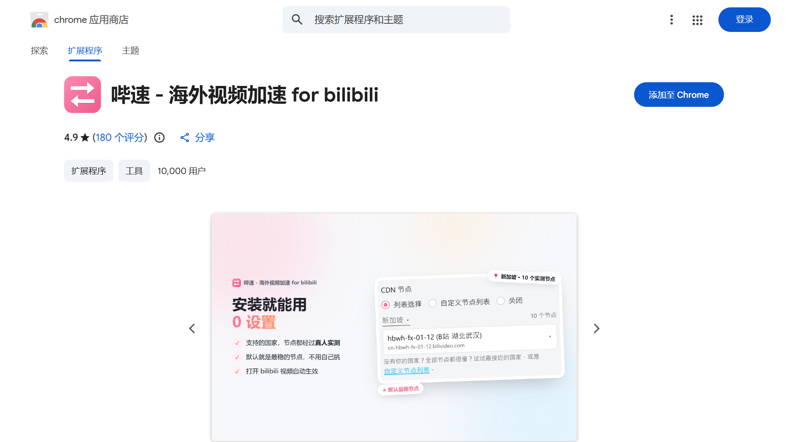
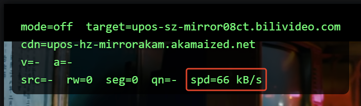
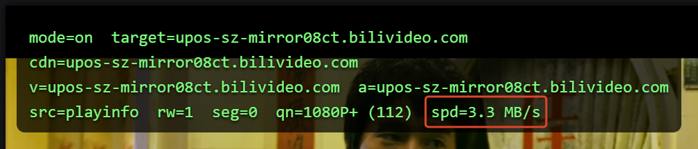

<div align="center">

#  哔速 - 海外视频加速 for bilibili

**语言 / Language：** [繁體中文](README.zh-TW.md)｜简体中文（本页）｜[English](../README.md)｜[日本語](README.ja.md)｜[한국어](README.ko.md)

### 让海外用户看网页版 B 站更顺，无缓冲播放 4K，不再遭受卡顿的扩展

</div>

 [Chrome Web Store](https://chromewebstore.google.com/detail/dfaddcffoondcendifiljhdbdagebgch?utm_source=github&utm_medium=referral&utm_campaign=readme&utm_content=zhcn)<br>
 [Firefox Add-ons](https://addons.mozilla.org/addon/bilibili-cdn-switcher?utm_source=github&utm_medium=referral&utm_campaign=readme&utm_content=zhcn)<br>
 [Edge Add-ons](https://microsoftedge.microsoft.com/addons/detail/dllallgilijcacpdemjafegibdafcbdp?utm_source=github&utm_medium=referral&utm_campaign=readme&utm_content=zhcn)<br>
 [Safari（Mac）](https://apps.apple.com/us/app/id6817181919?platform=mac&l=zh-Hans-CN&pt=129529980&ct=github_readme_zhcn)<br>
 [Safari（iPhone／iPad）](https://apps.apple.com/us/app/id6817181919?platform=iphone&l=zh-Hans-CN&pt=129529980&ct=github_readme_zhcn_ios)

---

<div align="center">



</div>

---

使用前（关闭扩展）



使用后（启用扩展）



## ✨ 这个扩展在做什么

**🎯 主要是为了让海外（中国大陆以外）的用户看网页版 B 站（www.bilibili.com）更顺。**

B 站默认分配的取流节点对海外用户常常绕路、不够快。这个扩展会**把视频的取流 CDN 重排、换成一个对你所在地区实测较快的最优节点**，让缓冲与加载更顺。

| 功能 | 说明 |
|:--|:--|
| 🚀 **零设置，开箱即用** | 安装后就在后台按 IP 判断你所在的国家，自动换成该国实测最快的 CDN，不用打开设置、也不用自己挑节点 |
| 🧑‍🔬 **真人测速，多国支持** | 每个国家的节点列表，都是当地用户用自己的网络真人实测后挑出来的。已支持台湾、新加坡、香港、日本、澳大利亚、美国、澳门、英国、西班牙、俄罗斯，其他国家陆续上线；没有专属列表的地区，会使用从各国报告中挑出、跨地区通用的「其他地区」列表 |
| ✏️ **自定义节点列表** | 按你的网络环境定制专属节点：下载官方测速工具 **[CDNSpeedTest](https://lazy-cv.com/docs/bilibili-cdn-speedtest?utm_source=github&utm_medium=referral&utm_campaign=readme&utm_content=zhcn)**（Windows／Mac）测一次，最适合你的节点会自动加进扩展；也可以自己输入多个 CDN host，同样支持测速与排序 |
| 📶 **各节点测速** | popup 内的测速页（视频、直播共用），显示视频标题／画质，实测当前视频、当前画质下各节点的下载速度并逐一列出，标示够看 8K／4K／1080P／720P 还是可能卡顿；点任一行就切换到该节点，测速中可以停止或重新测，离开该页即中止 |
| 🔁 **卡顿自动优化节点** | 检测到当前 CDN 分段请求失败、或播放持续卡住（非单纯缓冲已满）时，每个视频先在后台测一次当前列表的节点：当前节点达到 4K 标准（25 Mbps）就不换，否则换成第一个达标的节点（都没达标就换测到最快的），并保存为你的节点；之后还是卡住，才静默切换到 B 站原生给的备用节点（显示提示，通常不整页刷新）；备用节点也不行时弹出提示，让你自行决定是否切到「备用URL」。可在高级设置的「速度不佳时自动优化节点」开关关闭（默认开启）；网络本身不稳时建议关闭 |
| 📺 **直播支持** | 「直播」标签页可在 国际线路(ov)／国际备用线路(ov-b)／中国线路(cn)／中国备用线路(cn-b) 之间切换，不整页重载；进入直播间播放后才会显示各线路的实际地址，当前直播没有的线路会标注并变淡（仍可选）。直播线路不佳时，「速度不佳时自动优化节点」会自动退回国际线路(ov)（只针对该直播间，不改变你长期的选择） |
| 🦊 **Chrome / Firefox / Edge / Safari 四平台** | 同一份 `src/`，打包时按浏览器各自生成 zip（Edge 是 Chromium 内核，直接沿用 Chrome 的 manifest）；Safari 另用 Xcode 打包成 `.app`（见下方「打包 Safari」） |
| 🌏 **多语言界面** | 按浏览器语言自动显示繁體中文／简体中文／English／日本語／한국어（也可在高级设置手动选择），涵盖 popup、页面提示与 debug 浮层 |
| 💬 **问题反馈／功能许愿** | 在 popup 里直接反馈问题或许愿新功能，提交后会在 GitHub 开 issue 方便跟踪进度；反馈问题时附上的完整诊断数据不会公开 |
| 📢 **公告** | 主页上方的公告栏显示你所在国家的公告（例如测速抽奖活动），点开可看全文 |
| ☕ **赞助・金主爸爸排行榜** | 哔速永久免费；想支持开发可以从主页赞助，并登上按累计金额排序的金主爸爸排行榜（Safari 版没有赞助） |
| 🐛 **debug 浮层** | 查看当前 CDN 节点（默认关闭，可在右上角齿轮的高级设置中打开） |

---

## 🗂️ 项目结构

```text
bilibili-cdn-switcher/
├── src/                  ← 扩展本体（加载已解压 / 打包的就是这层）：manifest、popup、注入 B 站页面的脚本、
│                            赞助／公告／问题反馈页、节点列表 cdn-list.json、更新记录 changelog.json、五语言 _locales/
├── safari/               ← Safari 扩展的 Xcode 工程（safari-web-extension-converter 生成，用相对路径直接引用 ../../../src/）
├── tools/
│   ├── cdn-speedtest-app/    ← 官方测速工具 CDNSpeedTest（Python，Windows／Mac）
│   ├── report-worker/        ← api.biboost.app：问题反馈、公告、赞助等 API（Cloudflare Worker）
│   │                         同一域名上的账号／订阅 API（/auth/*、/me、/play/*、/stripe/*、/config/*）由 biboost-mobile repo 的 api-worker 提供，数据表放在这个项目的 Neon Postgres（bilibili-cdn-switcher：production 分支给 api.biboost.app、staging 分支给 api-staging.biboost.app），扩展与 App 共用同一个后台、同一个数据库
│   ├── site/                 ← biboost.app 网站（Cloudflare Worker）
│   └── translate-worker/     ← 后台用的翻译 API（Cloudflare Worker）
├── scripts/              ← 开发／打包／发版／运营脚本（以 Node 为主，少数 Python）
├── test/                 ← 单元测试（npm test）
├── assets/               ← 图标母档 512px 与正式版图标（icons-prod 由 gen-icons.mjs 生成）
├── docs/                 ← README 截图、平台图标 + 繁體中文／简体中文／日本語／한국어 README
├── dist/                 ← 打包产物（Chrome/Firefox/Edge 是 .zip；Safari 是 .app）
├── .githooks/            ← pre-push 更新记录检查、私人仓库自动同步
├── .github/workflows/    ← GitHub Actions：Safari 打包上架、Mac 版测速工具打包等
├── package.json          ← scripts/*.mjs 与测试用的 Node 依赖
├── .env.local.example    ← 本机凭证示例：商店上架密钥、bilibili 登录 cookie（复制成 .env.local 再填）
└── README.md
```

商店文案与截图（`store/`）、推广、研究资料等不公开的文件放在另一个私人仓库，不在这里（见 `scripts/private-repo.mjs`）。

打包相关的脚本（`build.mjs`、`build-safari.mjs`、`gen-icons.mjs` 等）都是纯 Node（配合 [jszip](https://npm.im/jszip) 打包 zip、[sharp](https://npm.im/sharp) 处理图片），
不依赖 Windows 专属的 PowerShell／System.Drawing，Mac／Linux 一样能跑，只要先 `npm install` 装好依赖即可。

### 📦 打包（上架 Chrome Web Store / Firefox Add-ons / Microsoft Edge Add-ons 用）

这个项目不需要编译／transpile，`src/` 底下就是可以直接 `Load unpacked` 的源码；「打包」只是把它压成上架用的 zip，
**没有自动化（例如 push 前自动打包）**，要更新 `dist/` 得自己手动跑一次：

```bash
npm install                          # 第一次执行，或 node_modules 被清掉时才需要
npm run build                        # 默认：Chrome + Firefox + Edge 都打包
npm run build -- --browser=chrome     # 只打包 Chrome
npm run build -- --browser=firefox    # 只打包 Firefox
npm run build -- --browser=edge       # 只打包 Edge
```

Chrome／Edge 用同一份 `src/manifest.json`（Edge 是 Chromium 内核，Manifest V3 与 Chrome 完全兼容，
不需要另外的 manifest），Firefox 用 `src/manifest.firefox.json`。会读取对应 manifest 的 `version`，
把 `src/` **底下的内容**（manifest 换成 `manifest.json` 放在 zip 最上层）压成
`dist/bilibili-cdn-switcher-<browser>-<版本>.zip`。Chrome／Firefox 两份 manifest 的 `version`
要保持一致，不一致时脚本会弹出警告（Edge 沿用 Chrome 的 manifest，版本必然一致，不用另外检查）。

打包结果是可重现的（reproducible build）：只要 `src/` 内容没变，同一个浏览器目标每次打出来的
zip bytes 完全相同（跨 Windows／Mac 也一样），方便日后接 CI 时判断 `dist/` 是否真的需要更新。

### 🧪 测试

```bash
npm test                             # 跑 test/*.test.mjs（Node 内置 test runner）
npm run test:whats-new               # 用 puppeteer 的 Chrome 加载 src/，自动测试「更新内容」popup
```

### 📝 更新记录与发版

- `src/changelog.json` 同时记录「尚未上架的新功能（`unreleased`）」与「各已上架版本相较上一版追加的内容（`releases`）」，五语言（zh_TW / zh_CN / en / ja / ko）。
  老用户更新后第一次打开 popup，会看到一次性的「更新内容」popup（内容就来自这份文件；打包进 zip 时会自动去掉 `unreleased`）。
- `.githooks/pre-push`：push 时若相较于分支出来的基准 `src/changelog.json` 没有变动，会询问是否仍要 push，选 No 就拦下。
  `npm install` 会自动设置 `core.hooksPath`（或手动 `git config core.hooksPath .githooks`）。确定不需要记录时：`CHANGELOG_CHECK_IGNORE=1 git push`。
- 发版用 Claude Code 的 `/release`（`.claude/skills/release/SKILL.md`）；上架密钥放在 `.env.local`（见 `.env.local.example`）。商店的「发布」按钮一律人工点击。
- `npm run package`：除了 `dist/` 的商店上传 zip，另外把离线安装用的 zip 与 `CDNSpeedTest.exe` 打包到 `release/`，由 `/release` 上传到该版本的 GitHub Release。

### 🍎 打包 Safari（上架 App Store 用）

Safari 扩展不能像 Chrome 那样直接加载 zip，必须打包成一个「内含扩展的 App」（macOS 是 `.app`、iOS 是 `.ipa`），
通过 App Store 分发。`safari/` 底下就是 `xcrun safari-web-extension-converter` 生成的 Xcode 工程，里面用相对路径
（`../../../src/`）直接引用仓库的 `src/`，所以**改 `src/` 不需要同步任何文件**，重新打包就会带上最新内容；换到任何一台
Mac clone 整个仓库都能跑（工程里没有写死的绝对路径）。

**需求**：一台装了完整 Xcode 的 Mac（只有 Command Line Tools 不够）。

```bash
npm run build:safari                       # macOS，Release，ad-hoc 签名 → dist/
npm run build:safari -- --platform=ios     # 改为打包 iOS
npm run build:safari -- --configuration=Debug
```

脚本会调用 `xcodebuild`，并把 `MARKETING_VERSION` 覆盖成 `src/manifest.json` 的 `version`（让 .app 内部版本跟扩展一致，
Xcode 工程默认写死 1.0），产出两个东西：

- `dist/Bilibili CDN Switcher (<平台>).app` —— 可直接双击安装／测试的 App
- `dist/bilibili-cdn-switcher-safari-<平台>-<版本>.zip` —— 对齐其他平台的 `bilibili-cdn-switcher-<平台>-<版本>` 命名规范，方便传到别的机器

⚠️ 这里是 **ad-hoc 签名，只供本机测试**。真正上架 App Store 仍需在 Xcode 打开 `safari/` 里的工程 →
Product > Archive > Distribute App，用你的 Apple Developer 账号签名上传（这步需要签名证书，无法纯命令行完成）。

### 🎨 重新生成图标

```bash
npm run gen-icons
```

以 512px 母档缩出 16/32/48/128，同时生成两份：`src/icons/`（开发版，带红点角标，`Load unpacked` 平常读到的就是这份，方便跟已安装的正式版区分）与 `assets/icons-prod/`（正式版，无角标）。`scripts/build.mjs` 打包 zip 时会自动把图标换成 `assets/icons-prod/` 底下的正式版。

## 🎛️ UI 说明

| 选项 | 行为 |
|:--|:--|
| 🏠 **主页** | 上方是公告栏，中间是「启用」开关与视频／直播的节点设置。最下方有评分、赞助、问题反馈三个按钮，以及版本号（点开看完整更新记录） |
| 🔄 **这个标签页需要刷新** | 扩展刚安装或更新时，已打开的 B 站标签页要刷新才会生效，popup 会提示并附「刷新」按钮 |
| 📢 **公告栏** | 只显示你所在国家的公告（例如测速抽奖活动），点开看全文。按 × 可关闭该条，3 天内不再显示 |
| 🔘 **启用** | 总开关，默认开启，同时管视频与直播。关闭后完全不改动 B 站取流 |
| 🎞️ **视频／直播标签页** | 「启用」下面分成视频、直播两个标签页。在直播间打开时会自动停在「直播」 |
| 📡 **CDN 线路** | 「列表选择」／「自定义节点列表」／「关闭」三选一，默认是列表选择。列表按国家列出实测最快的 10 多个节点，覆盖所有 ISP 用户，安装后会按 IP 自动选好你的国家；没有专属列表的国家用「其他地区」。自定义节点列表可自己输入 host，或用 CDNSpeedTest 测完自动加入 |
| 🔍 **测试各节点速度** | 用当前视频、当前画质实测列表内每个节点的下载速度，前三名戴上皇冠。点任一行就切换到该节点；可随时停止或重新测速 |
| ☕ **赞助・金主爸爸排行榜** | 按累计金额排名的金主爸爸排行榜，通过 Stripe 赞助。赞助不会解锁任何功能，Safari 版没有这个按钮 |
| 💬 **问题反馈／功能许愿** | 在独立窗口反馈问题或许愿，提交后会在 GitHub 开 issue。反馈问题时附上的完整诊断数据不会公开 |
| 📺 **直播线路** | 在国际线路(ov)／国际备用线路(ov-b)／中国线路(cn)／中国备用线路(cn-b) 之间选择，默认国际线路(ov)。记住的是线路种类，换直播间也适用 |
| 🔍 **测试各直播线路速度** | 在直播间播放时，实测每条线路的切台卡顿（起播时间）与持续观看（是否跟得上），以绿／黄／红标示好坏 |
| ⚙️ **高级设置（右上角齿轮）** | 语言、外观主题、自动优化、测速门槛、节点排序、debug 浮层等设置都在这里。最下方的「恢复原始设置」可一键恢复默认 |
| 🌏 **语言** | 默认跟随浏览器语言，支持繁體中文／简体中文／English／日本語／한국어，也可在高级设置手动指定 |
| 🎨 **外观主题** | 跟随系统（默认）／浅色／深色 |
| 🔁 **卡顿自动优化节点** | 检测到卡顿或分段加载失败时，先在后台测速并换到够看 4K（25 Mbps）的节点；还是卡就切到 B 站原生的备用节点。默认开启，网络本身不稳时建议关闭 |
| ⚡ **安装后第一个视频自动优化节点** | 全新安装后只执行一次：第一个视频播放约 5 秒后在后台测速，当前节点不够快就自动换掉 |
| ⏱️ **测速门槛** | 视频、直播各自可选「快／适中／准确」三种预设或自定义数字，调整测速的时长与准确度 |
| 🔢 **节点按测速排序** | 默认开启。测完的节点会由快到慢排列，主页列表也按这个顺序 |
| 🐛 **显示页面 debug 浮层** | 默认关闭。开启后在播放器左上角显示当前使用的节点等技术信息 |
| ♻️ **恢复原始设置** | 所有设置恢复默认，并清空自定义节点列表 |

<details>
<summary>🔍 <b>Debug 浮层长什么样</b>（播放器左上角）</summary>

视频页：

```text
mode=on  target=<你选的节点>
auto-fallback -> <自动切换到的备用节点>        ← 自动切换过才会出现
cdn=<当前实际串流的 host>
v=<video 主用 host>  a=<audio 主用 host>
src=playinfo|playurl  rw=<改写次数>  seg=<分段替换数>  qn=<画质>  spd=<速度>
buf=<前方缓冲>s  rs=<readyState> [paused]  stall=<卡住秒数>/<门槛>  fb=<备用次数>/2 [cd=<冷却剩余>]  lat=<分段延迟>
err=<最后一次错误> (<N>s ago)                    ← 有错误才会出现
-<N>s  <最近的事件>                              ← 最多 3 条
```

直播间：

```text
mode=on  target=<你选的线路>
auto-fallback -> <自动退回的线路>              ← 自动退回过才会出现
cdn=<当前实际串流的 host>
proto=<协议>  cluster=<集群号>  orig=<原始线路>  seg=<分段替换数>  pin=<playinfo 是否已锁定>
（以下与视频页相同：buf=… / err=… / 最近事件）
```

</details>

---

## ☕ 请我喝杯咖啡

哔速永久免费，由一位独立开发者下班后维护。如果你喜欢它，欢迎请我喝杯咖啡！为了感谢你的慷慨，可以自选名字与头像登上金主爸爸榜哦

<div align="center">

<a href="https://biboost.app/donate?utm_source=github&utm_medium=referral&utm_campaign=readme&utm_content=zhcn"></a>

<a href="https://biboost.app/donate?utm_source=github&utm_medium=referral&utm_campaign=readme&utm_content=zhcn"></a>

<sub>用手机扫码也能赞助</sub>

</div>

---

## 📜 授权 License

源码公开，采用自定义的 **[Source-Available License](../LICENSE)**：

- ✅ 可以查看、Fork、修改源码，个人使用、教学／研究等非商业用途均可自由进行
- ❌ 不可将本项目或修改版重新包装成竞争性的浏览器扩展／App／服务并对外发布上架，也不可移除版权声明
- 完整条款请见 [LICENSE](../LICENSE)；商业合作或例外授权需求欢迎开 issue 联系

隐私政策：[PRIVACY.md](../PRIVACY.md)

---

<div align="center">

Made with ❤️ for bilibili viewers overseas · 灵感致谢 [@roge4444](https://github.com/roge4444) 的 [PiliNaraRogerMod](https://github.com/roge4444/PiliNaraRogerMod) ／ [blblRogerMod](https://github.com/roge4444/blblRogerMod)

</div>
