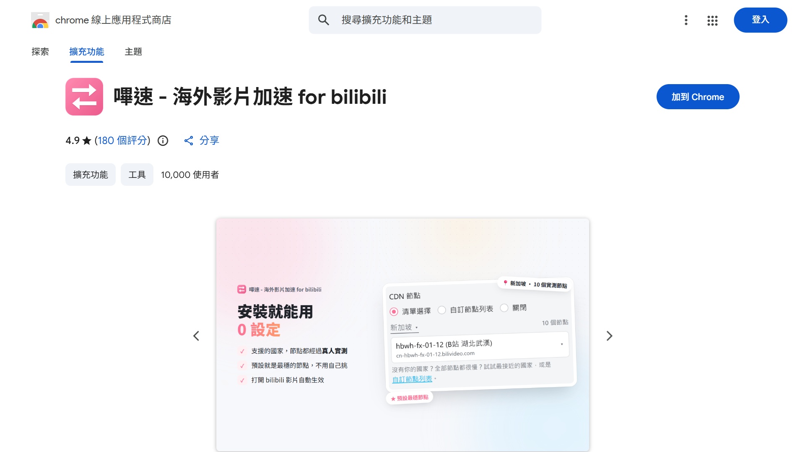
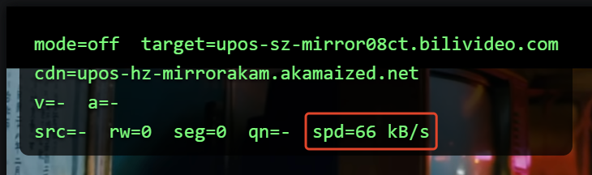
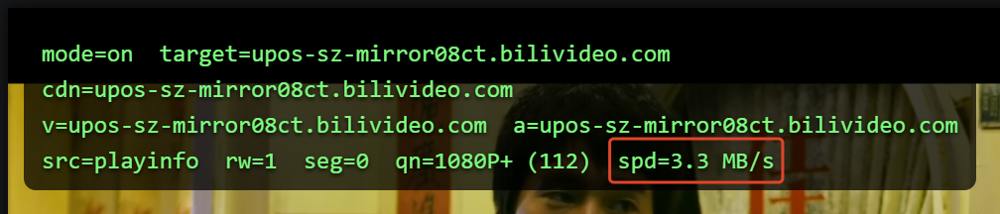

<div align="center">

#  嗶速 - 海外影片加速 for bilibili

**語言 / Language：** 繁體中文（本頁）｜[简体中文](README.zh-CN.md)｜[English](../README.md)｜[日本語](README.ja.md)｜[한국어](README.ko.md)

### 讓海外用戶看網頁版 B 站更順，無緩衝播放 4K，不再遭受卡頓的擴充

</div>

 [Chrome Web Store](https://chromewebstore.google.com/detail/dfaddcffoondcendifiljhdbdagebgch?utm_source=github&utm_medium=referral&utm_campaign=readme&utm_content=zhtw)<br>
 [Firefox Add-ons](https://addons.mozilla.org/addon/bilibili-cdn-switcher?utm_source=github&utm_medium=referral&utm_campaign=readme&utm_content=zhtw)<br>
 [Edge Add-ons](https://microsoftedge.microsoft.com/addons/detail/dllallgilijcacpdemjafegibdafcbdp?utm_source=github&utm_medium=referral&utm_campaign=readme&utm_content=zhtw)<br>
 [Safari（Mac）](https://apps.apple.com/tw/app/id6817181919?platform=mac&pt=129529980&ct=github_readme_zhtw)<br>
 [Safari（iPhone／iPad）](https://apps.apple.com/tw/app/id6817181919?platform=iphone&pt=129529980&ct=github_readme_zhtw_ios)

---

<div align="center">



</div>

---

使用前（關閉擴充）



使用後（啟用擴充）



## ✨ 這個擴充在做什麼

**🎯 主要是為了讓海外（中國大陸以外）的使用者看網頁版 B 站（www.bilibili.com）更順。**

B 站預設分配的取流節點對海外使用者常常繞路、不夠快。這個擴充會**把影片的取流 CDN 重排、換成一個對你所在地區實測較快的最優節點**，讓緩衝與載入更順。

| 功能 | 說明 |
|:--|:--|
| 🚀 **0 設定，開箱即用** | 安裝後就在背景依 IP 判斷你所在的國家，自動換成該國實測最快的 CDN，不用打開設定、也不用自己挑節點 |
| 🧑‍🔬 **真人測速，多國支援** | 每個國家的節點清單，都是當地使用者用自己的網路真人實測後挑出來的。已支援台灣、新加坡、香港、日本、澳洲、美國、澳門、英國、西班牙、俄羅斯，其他國家陸續上線；沒有專屬清單的地區，會用從各國報告挑出、跨地區通用的「其他地區」清單 |
| ✏️ **自訂節點列表** | 按照你的網路環境客製專屬節點：下載官方測速工具 **[CDNSpeedTest](https://lazy-cv.com/docs/bilibili-cdn-speedtest?utm_source=github&utm_medium=referral&utm_campaign=readme&utm_content=zhtw)**（Windows／Mac）測一次，最適合你的節點會自動加進擴充；也可以自己輸入多個 CDN host，同樣支援測速與排序 |
| 📶 **各節點測速** | popup 內的測速頁（影片、直播共用），顯示影片標題／畫質，實測當前影片、當前畫質下各節點的下載速度並逐一列出，標示夠看 8K／4K／1080P／720P 還是可能卡頓；點任一列就切換到該節點，測速中可以停止或重新測，離開該頁即中止 |
| 🔁 **卡頓自動優化節點** | 偵測到目前 CDN 分段請求失敗、或播放持續卡住（非單純緩衝已滿）時，每支影片先在背景測一次目前清單的節點：目前節點達到 4K 標準（25 Mbps）就不換，否則換成第一個達標的節點（都沒達標就換測到最快的），並存成你的節點；之後還是卡住，才靜默切換到 B 站原生給的備援節點（顯示提示，通常不整頁刷新）；備援也不行時彈出提示，讓你自行決定是否切到「備用URL」。可在進階設定的「速度不佳時自動優化節點」開關關閉（預設開啟）；網路本身不穩時建議關閉 |
| 📺 **直播支援** | 「直播」分頁可在 國際線路(ov)／國際備用線路(ov-b)／中國線路(cn)／中國備用線路(cn-b) 之間切換，不整頁重載；進入直播間播放後才會顯示各線路的實際網址，當前直播沒有的線路會標註並變淡（仍可選）。直播線路不佳時，「速度不佳時自動優化節點」會自動退回國際線路(ov)（只針對該直播間，不改變你長期的選擇） |
| 🦊 **Chrome / Firefox / Edge / Safari 四平台** | 同一份 `src/`，打包時依瀏覽器各自產生 zip（Edge 是 Chromium 內核，直接沿用 Chrome 的 manifest）；Safari 另用 Xcode 包成 `.app`（見下方「打包 Safari」） |
| 🌏 **多語系介面** | 依瀏覽器語言自動顯示繁體中文／简体中文／English／日本語／한국어（也可在進階設定手動選擇），涵蓋 popup、頁面提示與 debug 疊層 |
| 💬 **問題回報／功能許願** | 在 popup 裡直接回報問題或許願新功能，送出後會在 GitHub 開 issue 方便追蹤進度；回報問題時附上的完整診斷資料不會公開 |
| 📢 **公告** | 主頁上方的公告列顯示你所在國家的公告（例如測速抽獎活動），點開可看全文 |
| ☕ **贊助・乾爹排行榜** | 嗶速永久免費；想支持開發可以從主頁贊助，並登上依累計金額排序的乾爹排行榜（Safari 版沒有贊助） |
| 🐛 **debug 疊層** | 查看當前 CDN 節點（預設關閉，可在右上角齒輪的進階設定中打開） |

---

## 🗂️ 專案結構

```text
bilibili-cdn-switcher/
├── src/                  ← 擴充本體（載入未封裝 / 打包的就是這層）：manifest、popup、注入 B 站頁面的腳本、
│                            贊助／公告／問題回報頁、節點清單 cdn-list.json、更新紀錄 changelog.json、五語系 _locales/
├── safari/               ← Safari 擴充的 Xcode 工程（safari-web-extension-converter 產生，用相對路徑直接引用 ../../../src/）
├── tools/
│   ├── cdn-speedtest-app/    ← 官方測速工具 CDNSpeedTest（Python，Windows／Mac）
│   ├── report-worker/        ← api.biboost.app：問題回報、公告、贊助等 API（Cloudflare Worker）
│   │                         同一網域上的帳號／訂閱 API（/auth/*、/me、/play/*、/stripe/*、/config/*）由 biboost-mobile repo 的 api-worker 提供：擴充與 App 共用同一個後台、同一顆 Cloudflare D1：biboost-api（正式，a2105ace-b9ed-43af-aaaf-96ffbd8e004a）／biboost-api-dev（api-staging.biboost.app，61dc44f6-3bb4-49f0-8ee0-eb633605d6e9）
│   ├── site/                 ← biboost.app 網站（Cloudflare Worker）
│   └── translate-worker/     ← 後台用的翻譯 API（Cloudflare Worker）
├── scripts/              ← 開發／打包／發版／營運腳本（Node 為主，少數 Python）
├── test/                 ← 單元測試（npm test）
├── assets/               ← 圖示母檔 512px 與正式版圖示（icons-prod 由 gen-icons.mjs 產生）
├── docs/                 ← README 截圖、平台圖示 + 繁體中文／简体中文／日本語／한국어 README
├── dist/                 ← 打包產物（Chrome/Firefox/Edge 是 .zip；Safari 是 .app）
├── .githooks/            ← pre-push 更新紀錄檢查、私人 repo 自動同步
├── .github/workflows/    ← GitHub Actions：Safari 打包上架、Mac 版測速工具打包等
├── package.json          ← scripts/*.mjs 與測試用的 Node 依賴
├── .env.local.example    ← 本機憑證範例：商店上架金鑰、bilibili 登入 cookie（複製成 .env.local 再填）
└── README.md
```

商店文案與截圖（`store/`）、推廣、研究資料等不公開的檔案放在另一個私人 repo，不在這裡（見 `scripts/private-repo.mjs`）。

打包相關的腳本（`build.mjs`、`build-safari.mjs`、`gen-icons.mjs` 等）都是純 Node（配 [jszip](https://npm.im/jszip) 打包 zip、[sharp](https://npm.im/sharp) 處理圖片），
不依賴 Windows 專屬的 PowerShell／System.Drawing，Mac／Linux 一樣能跑，只要先 `npm install` 裝好依賴即可。

### 📦 打包（上架 Chrome Web Store / Firefox Add-ons / Microsoft Edge Add-ons 用）

這個專案不需要編譯／transpile，`src/` 底下就是可直接 `Load unpacked` 的原始碼；「打包」只是把它壓成上架用的 zip，
**沒有自動化（例如 push 前自動打包）**，要更新 `dist/` 得自己手動跑一次：

```bash
npm install                          # 第一次執行，或 node_modules 被清掉時才需要
npm run build                        # 預設：Chrome + Firefox + Edge 都打包
npm run build -- --browser=chrome     # 只打包 Chrome
npm run build -- --browser=firefox    # 只打包 Firefox
npm run build -- --browser=edge       # 只打包 Edge
```

Chrome／Edge 用同一份 `src/manifest.json`（Edge 是 Chromium 內核，Manifest V3 與 Chrome 完全相容，
不需要另外的 manifest），Firefox 用 `src/manifest.firefox.json`。會讀對應 manifest 的 `version`，
把 `src/` **底下的內容**（manifest 換成 `manifest.json` 放在 zip 最上層）壓成
`dist/bilibili-cdn-switcher-<browser>-<版本>.zip`。Chrome／Firefox 兩份 manifest 的 `version`
要保持一致，不一致時腳本會跳警告（Edge 沿用 Chrome 的 manifest，版本必然一致，不用另外檢查）。

打包結果是可重現的（reproducible build）：只要 `src/` 內容沒變，同一個瀏覽器目標每次包出來的
zip bytes 完全相同（跨 Windows／Mac 也一樣），方便日後要接 CI 時判斷 `dist/` 是否真的需要更新。

### 🧪 測試

```bash
npm test                             # 跑 test/*.test.mjs（Node 內建 test runner）
npm run test:whats-new               # 用 puppeteer 的 Chrome 載入 src/，自動測「更新內容」popup
```

### 📝 更新紀錄與發版

- `src/changelog.json` 同時記「尚未上架的新功能（`unreleased`）」與「各已上架版本相較前一版追加的內容（`releases`）」，五語（zh_TW / zh_CN / en / ja / ko）。
  老使用者更新後第一次打開 popup，會看到一次性的「更新內容」popup（內容就來自這份檔案；打包進 zip 時會自動拿掉 `unreleased`）。
- `.githooks/pre-push`：push 時若相較於分支出來的基準 `src/changelog.json` 沒有變動，會詢問是否仍要 push，選 No 就擋下。
  `npm install` 會自動設定 `core.hooksPath`（或手動 `git config core.hooksPath .githooks`）。確定不需要記錄時：`CHANGELOG_CHECK_IGNORE=1 git push`。
- 發版用 Claude Code 的 `/release`（`.claude/skills/release/SKILL.md`）；上架金鑰放 `.env.local`（見 `.env.local.example`）。商店的「發布」按鈕一律人工按。
- `npm run package`：除了 `dist/` 的商店上傳 zip，另外把離線安裝用的 zip 與 `CDNSpeedTest.exe` 打包到 `release/`，由 `/release` 上傳到該版本的 GitHub Release。

### 🍎 打包 Safari（上架 App Store 用）

Safari 擴充不能像 Chrome 那樣直接載入 zip，必須包成一個「內含擴充的 App」（macOS 是 `.app`、iOS 是 `.ipa`），
透過 App Store 分發。`safari/` 底下就是 `xcrun safari-web-extension-converter` 產生的 Xcode 工程，裡面用相對路徑
（`../../../src/`）直接引用倉庫的 `src/`，所以**改 `src/` 不需要同步任何檔案**，重新打包就會帶到最新內容；換到任何一台
Mac clone 整個倉庫都能跑（工程裡沒有寫死的絕對路徑）。

**需求**：一台裝了完整 Xcode 的 Mac（只有 Command Line Tools 不夠）。

```bash
npm run build:safari                       # macOS，Release，ad-hoc 簽章 → dist/
npm run build:safari -- --platform=ios     # 改打包 iOS
npm run build:safari -- --configuration=Debug
```

腳本會呼叫 `xcodebuild`，並把 `MARKETING_VERSION` 覆蓋成 `src/manifest.json` 的 `version`（讓 .app 內部版本跟擴充一致，
Xcode 工程預設寫死 1.0），產出兩個東西：

- `dist/Bilibili CDN Switcher (<平台>).app` —— 可直接雙擊安裝／測試的 App
- `dist/bilibili-cdn-switcher-safari-<平台>-<版本>.zip` —— 對齊其他平台的 `bilibili-cdn-switcher-<平台>-<版本>` 命名規範，方便傳給別台機器

⚠️ 這裡是 **ad-hoc 簽章，只供本機測試**。真正上架 App Store 仍需在 Xcode 開啟 `safari/` 裡的工程 →
Product > Archive > Distribute App，用你的 Apple Developer 帳號簽章上傳（這步需要簽章憑證，無法純命令列完成）。

### 🎨 重新產生圖示

```bash
npm run gen-icons
```

以 512px 母檔縮出 16/32/48/128，同時產生兩份：`src/icons/`（開發版，帶紅點角標，`Load unpacked` 平常讀到的就是這份，方便跟已安裝的正式版分辨）與 `assets/icons-prod/`（正式版，無角標）。`scripts/build.mjs` 打包 zip 時會自動把圖示換成 `assets/icons-prod/` 底下的正式版。

## 🎛️ UI 說明

| 選項 | 行為 |
|:--|:--|
| 🏠 **主頁** | 上方是公告列，中間是「啟用」開關與影片／直播的節點設定。最下方有評分、贊助、問題回報三顆按鈕，以及版本號（點開看完整更新紀錄） |
| 🔄 **這個分頁需要重新整理** | 擴充剛安裝或更新時，已開著的 B 站分頁要重新整理才會生效，popup 會提示並附「重新整理」按鈕 |
| 📢 **公告列** | 只顯示你所在國家的公告（例如測速抽獎活動），點開看全文。按 × 可關閉該則，3 天內不再顯示 |
| 🔘 **啟用** | 總開關，預設開啟，同時管影片與直播。關閉後完全不改動 B 站取流 |
| 🎞️ **影片／直播分頁** | 「啟用」下方分成影片、直播兩個分頁。在直播間打開時會自動停在「直播」 |
| 📡 **CDN 線路** | 「清單選擇」／「自訂節點列表」／「關閉」三選一，預設是清單選擇。清單依國家列出實測最快的 10 多個節點，覆蓋所有 ISP 用戶，安裝後會依 IP 自動選好你的國家；沒有專屬清單的國家用「其他地區」。自訂節點列表可自己輸入 host，或用 CDNSpeedTest 測完自動加入 |
| 🔍 **測試各節點速度** | 用目前影片、目前畫質實測清單內每個節點的下載速度，前三名戴上皇冠。點任一列就切換到該節點；可隨時停止或重新測速 |
| ☕ **贊助・乾爹排行榜** | 依累計金額排名的乾爹排行榜，透過 Stripe 贊助。贊助不會解鎖任何功能，Safari 版沒有這個按鈕 |
| 💬 **問題回報／功能許願** | 在獨立視窗回報問題或許願，送出後會在 GitHub 開 issue。回報問題時附上的完整診斷資料不會公開 |
| 📺 **直播線路** | 在國際線路(ov)／國際備用線路(ov-b)／中國線路(cn)／中國備用線路(cn-b) 之間選擇，預設國際線路(ov)。記住的是線路種類，換直播間也適用 |
| 🔍 **測試各直播線路速度** | 在直播間播放時，實測每條線路的切台卡頓（起播時間）與持續觀看（是否跟得上），以綠／黃／紅標示好壞 |
| ⚙️ **進階設定（右上角齒輪）** | 語言、外觀主題、自動優化、測速門檻、節點排序、debug 疊層等設定都收在這裡。最下方的「恢復原始設定」可一鍵回到預設 |
| 🌏 **語言** | 預設跟隨瀏覽器語言，支援繁體中文／简体中文／English／日本語／한국어，也可在進階設定手動指定 |
| 🎨 **外觀主題** | 跟隨系統（預設）／淺色／深色 |
| 🔁 **卡頓自動優化節點** | 偵測到卡頓或分段載入失敗時，先在背景測速並換到夠看 4K（25 Mbps）的節點；還是卡就切到 B 站原生的備援節點。預設開啟，網路本身不穩時建議關閉 |
| ⚡ **安裝後第一支影片自動優化節點** | 全新安裝後只執行一次：第一支影片播放約 5 秒後在背景測速，目前節點不夠快就自動換掉 |
| ⏱️ **測速門檻** | 影片、直播各自可選「快／適中／準確」三種預設或自訂數字，調整測速的時間長短與準確度 |
| 🔢 **節點按測速排序** | 預設開啟。測完的節點會由快到慢排列，主頁清單也照這個順序 |
| 🐛 **顯示頁面 debug 疊層** | 預設關閉。開啟後在播放器左上角顯示目前使用的節點等技術資訊 |
| ♻️ **恢復原始設定** | 所有設定回到預設，並清空自訂節點列表 |

<details>
<summary>🔍 <b>Debug 疊層長什麼樣</b>（播放器左上角）</summary>

影片頁：

```text
mode=on  target=<你選的節點>
auto-fallback -> <自動切換到的備援節點>        ← 有自動切換過才會出現
cdn=<當前實際串流的 host>
v=<video 主用 host>  a=<audio 主用 host>
src=playinfo|playurl  rw=<改寫次數>  seg=<分段替換數>  qn=<畫質>  spd=<速度>
buf=<前方緩衝>s  rs=<readyState> [paused]  stall=<卡住秒數>/<門檻>  fb=<備援次數>/2 [cd=<冷卻剩餘>]  lat=<分段延遲>
err=<最後一次錯誤> (<N>s ago)                    ← 有錯誤才會出現
-<N>s  <最近的事件>                              ← 最多 3 筆
```

直播間：

```text
mode=on  target=<你選的線路>
auto-fallback -> <自動退回的線路>              ← 有自動退回過才會出現
cdn=<當前實際串流的 host>
proto=<協定>  cluster=<集群號>  orig=<原始線路>  seg=<分段替換數>  pin=<playinfo 是否已鎖定>
（以下與影片頁相同：buf=… / err=… / 最近事件）
```

</details>

---

## ☕ 請我喝杯咖啡

嗶速永久免費，由一位獨立開發者下班後維護。如果你喜歡它，歡迎請我喝杯咖啡！為了感謝你的慷慨，可以自選名字與頭像登上乾爹列表喔

<div align="center">

<a href="https://biboost.app/donate?utm_source=github&utm_medium=referral&utm_campaign=readme&utm_content=zhtw"></a>

<a href="https://biboost.app/donate?utm_source=github&utm_medium=referral&utm_campaign=readme&utm_content=zhtw"></a>

<sub>用手機掃 QR code 也能贊助</sub>

</div>

---

## 📜 授權 License

原始碼公開，採自訂的 **[Source-Available License](../LICENSE)**：

- ✅ 可以查看、Fork、修改原始碼，個人使用、教學／研究等非商業用途皆可自由進行
- ❌ 不可將本專案或修改版重新包裝成競爭性的瀏覽器擴充／App／服務並對外發佈上架，也不可移除版權聲明
- 完整條款請見 [LICENSE](../LICENSE)；商業合作或例外授權需求歡迎開 issue 聯絡

隱私權政策：[PRIVACY.md](../PRIVACY.md)

---

<div align="center">

Made with ❤️ for bilibili viewers overseas · 靈感致謝 [@roge4444](https://github.com/roge4444) 的 [PiliNaraRogerMod](https://github.com/roge4444/PiliNaraRogerMod) ／ [blblRogerMod](https://github.com/roge4444/blblRogerMod)

</div>
